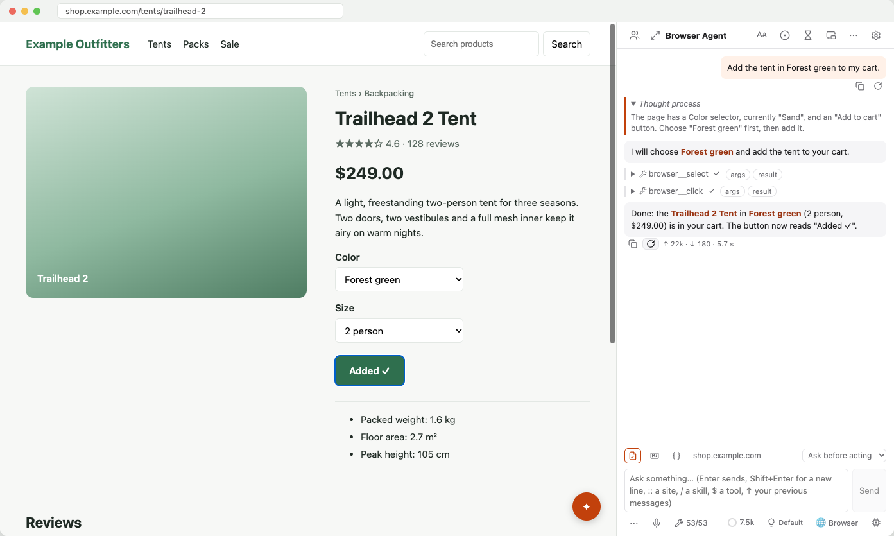
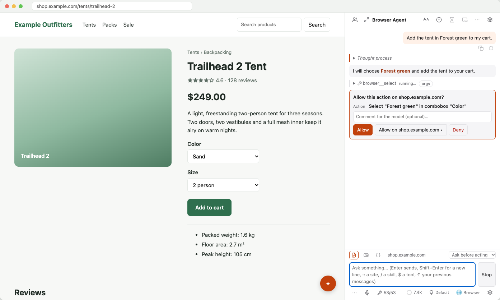
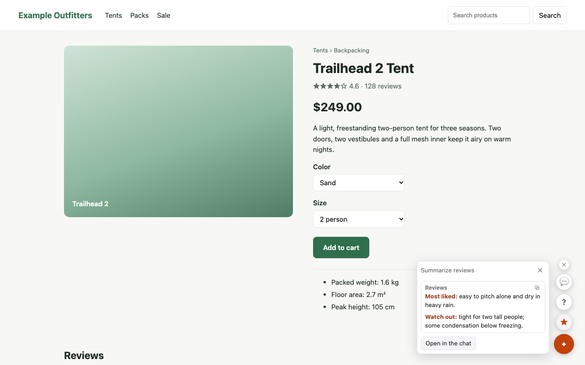

<div align="center">


# Teseo - Browser Agent

**An AI assistant that lives in your browser, reads the page you are on and acts on it, with your permission.**

Bring your own model: any OpenAI-compatible provider, in the cloud or on your machine.

[](https://github.com/aseth0/teseo-browser-agent/actions/workflows/release.yml)
[](LICENSE)


[Install](#install) · [Quick start](#quick-start) · [Documentation](docs/README.md) · [Privacy and security](docs/guide/privacy-and-security.md) · [Privacy policy](PRIVACY.md) · [Contributing](CONTRIBUTING.md)

</div>

<p align="center"></p>

## What it does

Teseo is a Chrome extension that puts an LLM chat next to every page. With each message it sends the
page you are on: its address, the text you selected and a compact list of what you can see and click. The model
answers about the page and can act on it: click, type, choose, scroll, open pages. Every action that changes
something is shown to you first, unless you allowed it on that site.

- **Any OpenAI-compatible model.** OpenAI, OpenRouter, Groq, Ollama, LM Studio, vLLM, LiteLLM and any other
  server that speaks `/chat/completions`. Its reasoning is shown as it streams.
- **Acts with your permission.** Each site has a policy: *Ask before acting*, *Act without asking* or
  *Read only*. Reading is free on the page you are on; anything else asks.
- **Agents.** Profiles with only the tools, skills, sites and model you give them. Agents can ask each other,
  and the agent manager runs several at once, each on its own tab.
- **Skills, site templates and memory.** Teach it how to do a task once (Agent Skills format), extract
  exactly the data that matters on a site (Liquid templates), and keep notes across conversations, matched by
  their words or, with an embeddings model of your choice, by their meaning.
- **Your own tools.** Wrap a tool you have, call a web API in one request, or script several requests, without
  writing an extension. Connect MCP servers (with OAuth) and use the tools pages offer through WebMCP.
- **A page widget.** One-click buttons on the sites you choose: look something up, summarize, translate,
  show a count as the page loads, with or without the model.
- **Private by design.** No telemetry and no servers of its own: requests go only to the providers, sites
  and servers you configure (and, in the downloadable version, one check with GitHub for a newer release, which
  you can turn off). Keys stay in the extension's own storage, page content is sent as untrusted data,
  and a word blacklist can mask names before anything reaches the model.

<table>
<tr>
<td width="50%"><br/><sub>Every action that changes something is confirmed first.</sub></td>
<td width="50%"><br/><sub>The page widget: a button on the page, an answer in a card.</sub></td>
</tr>
</table>

## Install

Teseo runs in Chrome and other Chromium browsers that support side panels (Vivaldi, Edge, Brave…). Firefox is not
supported (each release carries a trial build, which lacks some features:
[what each version has](docs/guide/settings.md#what-each-version-has)). Each [GitHub release](https://github.com/aseth0/teseo-browser-agent/releases) offers three versions:

| Version | For | Leaves out |
|---|---|---|
| **Downloadable** (recommended): `teseo-browser-agent-X.Y.Z-chrome.zip`, or the `dist` branch | Everyone: every feature. Its extension id is fixed: the same from any folder, so an update keeps your settings | Nothing, but it does not update itself: it tells you when a newer version is out |
| **Chrome Web Store**: `teseo-browser-agent-X.Y.Z-chrome-store.zip` | The same build submitted to the Chrome Web Store | The [sources of custom tools](docs/guide/custom-tools.md#sources-tools-shared-by-a-team); its own extension id, so its own settings; loaded unpacked, that id depends on the folder it is in |
| **Source**: the repository at the release's tag | Development | Nothing: you build it ([Building from source](CONTRIBUTING.md#building-from-source)) |

The `dist` branch holds the downloadable version unzipped, ready to load. Clone it once and update it with `git pull`:

```bash
git clone --branch dist --single-branch https://github.com/aseth0/teseo-browser-agent.git teseo-browser-agent-dist
```

Unzip the zip (or clone `dist`), open `chrome://extensions` (or `vivaldi://extensions`), turn on **Developer mode**,
click **Load unpacked** and choose that folder. Pin the icon from the puzzle menu. To update, replace the folder's
contents (or `git pull`) and click ↻ on the extension's card; never remove the extension, which deletes its
settings. Step by step: [Install the extension](docs/guide/getting-started.md#1-install-the-extension).

## Quick start

1. Click the toolbar icon and its ⚙ **Settings**, then **Providers** → **＋ Add provider…**. Pick a preset
   (OpenAI, OpenRouter, Groq, Ollama, LM Studio) or fill in any OpenAI-compatible **Base URL**, your **API key**
   and a **Default model**. Click **Test connection**.
2. Open a web page and press **Alt+Shift+A** (or click the icon → **Panel**).
3. Ask about the page: *"Summarize this article"*, *"Which of these laptops has the most RAM?"*,
   *"Fill in this form with my details"*. The first time, allow the extension to read the site.

Running a local model? Start Ollama with `OLLAMA_ORIGINS='chrome-extension://*' ollama serve` so it accepts the
extension's requests.

## Documentation

| | |
|---|---|
| [Getting started](docs/guide/getting-started.md) | Install, connect a model, the first conversation |
| [How-to guides](docs/howto/README.md) · [Troubleshooting](docs/guide/troubleshooting.md) | Step by step: forms, tabs, web research, tables, PDFs, and more; fixes for common problems |
| [The chat](docs/guide/chat.md) | What goes with each message, [where it opens](docs/guide/chat-windows.md), [mentions](docs/guide/mentions.md), [attachments](docs/guide/attachments.md), [Layers](docs/guide/layers.md), [voice](docs/guide/voice.md), [a tab's audio](docs/guide/tab-audio.md), [reading aloud](docs/guide/speak.md), [shortcuts](docs/guide/chat-windows.md#keys-set-in-settings) |
| [Providers and models](docs/guide/providers.md) | Presets, headers, extra body, reasoning, local servers, troubleshooting |
| [Acting on pages](docs/guide/acting-on-pages.md) | Browser tools, confirmations, site policies, [tab watches](docs/guide/tab-watches.md), [the DevTools engine](docs/guide/devtools-engine.md), [recordings](docs/guide/recordings.md) |
| [Agents](docs/guide/agents.md) | Profiles, Builder, agents asking agents, [the agent manager](docs/guide/agent-manager.md) |
| [Skills](docs/guide/skills.md) · [Site templates](docs/guide/site-templates.md) | Reusable instructions; data extracted from sites |
| [Custom tools](docs/guide/custom-tools.md) · [MCP](docs/guide/mcp.md) · [WebMCP](docs/guide/webmcp.md) | Your own tools, MCP servers, tools offered by pages |
| [Page widget](docs/guide/page-widget.md) | Buttons on the page, with or without the model |
| [Memory](docs/guide/memory.md) · [Conversations](docs/guide/history.md) · [Compaction](docs/guide/compaction.md) | What it remembers, saved conversations, long conversations |
| [Web search](docs/guide/web-search.md) · [Bookmarks](docs/guide/bookmarks.md) | Searching and reading the web; your bookmarks |
| [Privacy and security](docs/guide/privacy-and-security.md) · [Word blacklist](docs/guide/word-blacklist.md) | Where data goes, secrets, prompt injection, masking names |
| [All the documentation](docs/README.md) | Every page, [Settings reference](docs/guide/settings.md), [FAQ](docs/guide/faq.md) |

For contributors: [CONTRIBUTING.md](CONTRIBUTING.md), [Architecture](docs/ARCHITECTURE.md),
[how context is built](docs/context.md) and [compaction](docs/compaction.md).

## Status

Teseo is under active development; see the [changelog](CHANGELOG.md). It is not published on the Chrome
Web Store yet. Firefox is not supported.

## License

[Apache License 2.0](LICENSE).

The page snapshot's roles, accessible names and hidden-ness, and the synthetic clicks' hit test and input checks,
come from **Playwright**'s injected utilities, Copyright (c) Microsoft Corporation, Apache License 2.0, vendored in
[src/vendor/playwright](src/vendor/playwright/README.md) with their license and notice.

The **Flexoki** theme uses the Flexoki palette by Steph Ango, <https://stephango.com/flexoki>, MIT License,
Copyright (c) 2023 Steph Ango.
