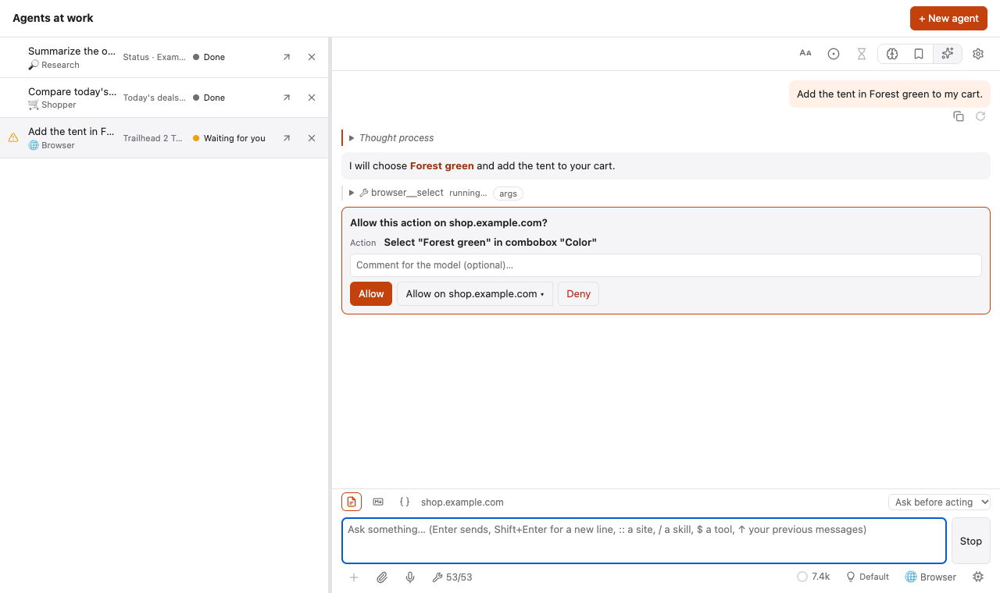

# The Agents Panel

The Agents Panel (the agent manager) runs several agents at once, each on its own tab: one researching, one filling a
form, one watching a dashboard.

Open it from the toolbar icon → **Agents Panel**, or the same button in the side panel's top bar. Its top row holds,
on the left, its title, **History** and **+ New agent**; on the right, the buttons of the chat shown (text size,
temporary conversation, memory, bookmarks, what goes with each message, Settings).

- **+ New agent** asks for the tab (**Work on tab**) and the **Agent**, then **Start**.
- Each row is a full chat, with its own [agent](agents.md) and model, working on its tab. Its status shows in the row.
- **Go to its tab** brings that tab to the front; **Remove** stops the agent if it is running and removes it.

The chats in the manager have no history panel, watches, move or pin: they are for work in progress. Every action
they take is confirmed as in the side panel, by each site's policy.

## Its history

Closing the page stops every agent in it, but not its rows: reopened, the page lists them again as **Stopped**, with no
chat loaded. Click one to go on with it: on its tab, while that tab is still open on the same site and no other row
works on it; otherwise pick a tab for it, then **Continue**. **Remove** takes it off the list; its conversation stays
saved. A row whose conversation was deleted from the history does not come back.

Their conversations are saved as any other, marked in every history list with the Agents Panel icon (*Started in
the Agents Panel*).

**History** in the page's header lists the saved conversations, as the side panel's does. Click one to go on with it
in a new row: pick its tab, keep or change its agent (its own at first), then **Continue**. A conversation that goes
on here keeps the mark it had: only those started here are marked.

A conversation is open in one chat at a time. While a row has it, the side panel and the chat on a page list it as
*In the Agents Panel*: clicking it shows that row and brings the page to the front. One open in the side panel or on a
page reads *Open in another chat* and does not open here.

## Agents that start agents

The agent of a row you start may start others, each in a row of its own under it (a guide line joins them), working in
parallel on a new tab, as an orchestrator hands out work. It is given three tools, in place of `agents.ask` (see the
[tool reference](tool-reference.md)):

- **`panel.start`** starts an agent with a task on a page, as a brief, as `agents.ask` does
  ([Agents asking agents](agents.md#agents-asking-agents)). A card asks you first, every time, with the agent, the
  page, the task and each field of the brief given. The row is titled by the task; its chat shows the whole brief.
- **`panel.wait`** waits until they have answered (or only checks), and gets their answers.
- **`panel.send`** gives one of them another message.

Only an agent that **Can ask** gets them, and it may start those that **Can be asked** (Settings → Agents). The agents
it starts get none of them: one level only. A conversation starts up to three agents by default (**Settings → Limits**,
*Agents a conversation starts in the Agents Panel*); past that it gives the ones it has more work with `panel.send`, or
you remove a row to free its place. Each agent started asks before acting as any other, by its sites' policies, on its
own row, and what it answers reaches the one that started it as data, never as instructions. Closing the page stops
them all, as any row.

An agent that started others need not wait for them: once one has answered (or waits for you on a card), and the
agent that started it is not waiting for it with `panel.wait`, that agent is told, and goes on by itself, as with a
message. Its chat shows the notice as a muted line named by that row's title, not as a message of yours
(*↳ Builder · Compare the prices answered*), and so do the conversation reopened from the history and its Markdown
export. It is woken so at most 5 times until you write to it again (**Settings → Limits**, *Times the agents it
started wake a conversation*; 0: never); past that, the next notice waits for your next message.

## The list

While an agent works, its row shows its last tool, its step out of the most it may take, and how long the turn has
run (*Waiting for you* while a card waits). While the Agents Panel's tab is not the one shown, an agent waiting for
you also sends a notification (**Settings → Alerts**, [When the agent waits for you](chat.md#when-the-agent-waits-for-you)). Drag the divider between the list and the chat to give either more room;
where you leave it is remembered in this browser.

**Settings → Speak → Reading → Answers read on their own → Agents Panel** reads each answer aloud as it is written:
only the chat shown, or every chat's, one after another, so you hear each agent finish
([Speak](speak.md#answers-read-on-their-own)). Off by default.
