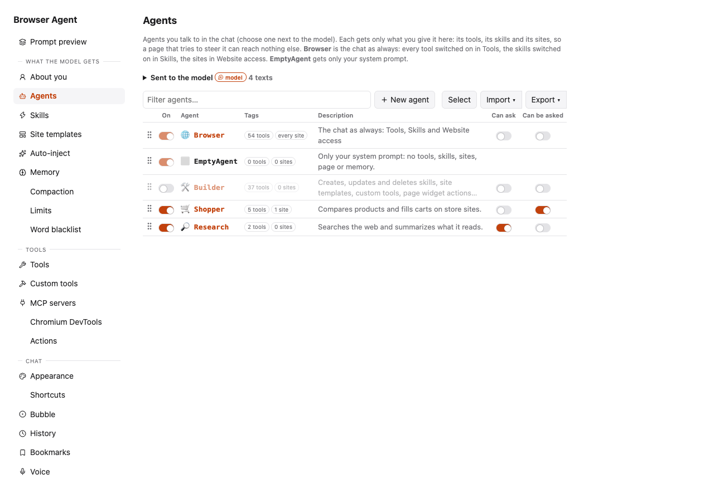

# Agents

An **agent** is a profile you talk to in the chat: a name, instructions, and only the tools, skills, sites and
model you give it. A page that tries to steer an agent can reach nothing else. Choose the agent next to the model
picker; manage them in **Settings → Agents**.

## Built-in agents

| Agent | What it is |
|---|---|
| 🌐 **Browser** | The chat as always: every tool switched on in Settings → Tools, every skill switched on, every site with its policy. You can edit its icon, description, instructions and memory ([Editing Browser](#editing-browser)). |
| ⬜ **EmptyAgent** | Only your system prompt: no tools, skills, sites, page or memory. A plain chat with the model. |
| 🛠️ **Builder** | Creates, updates and deletes skills, site templates, custom tools, page widget actions and agents, each reviewed by you. **Off** until you switch it on. |

While Builder is on, the tools that create things are **Builder's alone**: Browser is not offered them, and no
agent can hand them out. Making things becomes a deliberate step: you switch to Builder to make them.

## What an agent holds

| Field | |
|---|---|
| **Icon** and **Name** | |
| **Model** | A provider and model of its own, or *The chat's model* |
| **Description** | What it is for. Other agents read it to decide whether to ask it. |
| **Instructions** | Added after your system prompt. `{{about_user}}` inserts **Settings → About you**. |
| **Memory** | *External* (what it saves, every agent sees) or *Internal* (its alone) |
| **Tools** | Only those ticked; tools added later are not given to it |
| **Skills** and **Site templates** | By name |
| **Sites** | Each with its policy: *Ask before acting*, *Act without asking* or *Read only*. The chat opens with this agent on those sites. |
| **Only its sites** | It uses no other site, not even to read the page you are on |
| **Voice** | The [voice profile](speak.md#voice-profiles) its answers are read with (none: the default), and **Speaks on its own**, which offers it `speech.say` (off by default) |
| **Other agents** | *Can ask* other agents; *Can be asked* by them |

Agents can be reordered by dragging, switched on and off, and exported or imported as JSON, all of them or those
you choose with **Select** ([Backups](settings.md#backups)); imported ones arrive switched off.

### Editing Browser

Browser's editor has the same fields, with a difference: its tools, skills and site templates are those switched on
in **Settings → Tools**, **Skills** and **Site templates**, and changing them here changes them there. Its sites are
those of **Site policies**, and its name stays. Its **Voice** is kept like any agent's. Its **Can ask** and **Can be asked** work as any agent's: turn on
**Can be asked** to let your other agents hand Browser a task, with every tool and site it has.

The agent picker next to the model picker lists your agents in this order, then **Manage agents…**, which opens
Settings → Agents.

## Agents asking agents

An agent with **Can ask** gets a tool to hand a task to any agent with **Can be asked**. The asked agent:

- runs with its own model (or the caller's), tools, sites and instructions;
- gets the task as its only message, without the conversation;
- works in a background tab of its own.

Only its final answer comes back, as untrusted content; the chat shows its run as it goes. Agents can nest up to
three levels deep.

If the asked agent runs out of rounds of tool calls before it finishes, a card asks you: **Continue** lets it go on
where it was, with as many rounds again; **Stop** (or stopping the chat) gives the caller what it has, with a note
that it stopped early.

## Letting the model build agents

With Builder (or Browser, when Builder is off), the model can create or update agents with `agents.save`. You
review every save, an update as what changes. A model-built agent never gets *Act without asking* on a site, the
tools that create things, its own model or *Only its sites*: those are yours to set.
