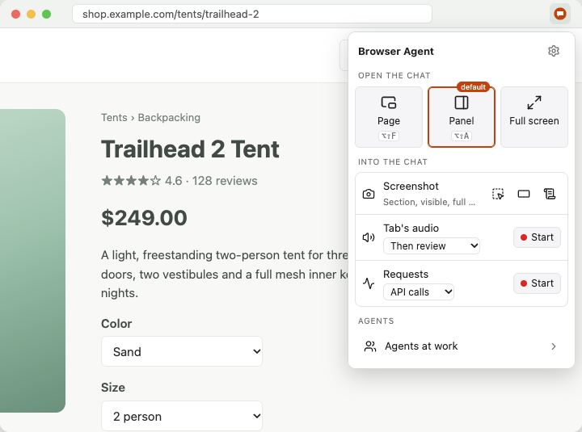

# Where the chat opens

The same chat can open in three places: the side panel, floating on the page, or full screen in a tab. The toolbar
button opens a popup, **Open the chat**, to choose (point at a tile for its full name):

The popup has three blocks, each under a small heading: **Open the chat**, **Into the chat** and **Agents**. A tile
shows its key when it has one, and the place the bubble opens the chat in (Settings → Bubble) is marked *default*. Which
tiles and lines it shows, and whether it shows the keys and the headings: [Settings → Appearance →
Popup](appearance.md#popup).

Above the blocks, a line says when the extension cannot work on the tab's site yet: ***site* is not enabled**, with
**Enable it**, which asks the browser for that site only (every site at once: **Settings → Website access**). The line
goes as soon as the site is allowed. On a page no extension may reach (browser pages such as `chrome://` or
`about:`, the Chrome Web Store, `file:` pages) it says *Teseo can't work on this page* instead, with nothing to do.

| In the popup | Opens |
|---|---|
| **Page** (*Chat on this page*) | The chat floating on the page itself |
| **Panel** (*Chat in the side panel*) | The chat next to the page: the usual place |
| **Full screen** (*Chat full screen in a tab*) | The chat full screen in a tab of its own |
| **Screenshot**: **Section**, **Visible**, **Full page** (the first line of *Into the chat*) | A [screenshot of the page](attachments.md#screenshots-from-the-popup-or-a-shortcut) attached to the chat's message box |
| **Tab's audio**: where it goes, then **● Start** | [A tab's audio](tab-audio.md) captured; while it captures, its time and **Stop** |
| **Requests**: a preset, then **● Start** (on [the DevTools engine](devtools-engine.md) also **Several tabs**, **Tabs and mouse**, as icons before it) | A [recording of the page's requests](recordings.md); while it records, *Recording requests* in the accent, its count and **Stop**, which opens the review in the chat |
| **Agents Panel** (under *Agents*) | The [agent manager](agent-manager.md), several agents at once |
| ⚙ **Settings** (top right) | The settings page |

Keyboard shortcuts. These are the browser's: they work everywhere, and only its shortcuts page changes them
(`chrome://extensions/shortcuts`, `vivaldi://extensions/shortcuts` in Vivaldi; **Settings → Shortcuts** → **Open the
browser's shortcuts page**). **Settings → Shortcuts** can also give each action a key of its own:
[keys set in Settings](#keys-set-in-settings).

| Shortcut | Does |
|---|---|
| **Alt+Shift+A** | Opens the side panel |
| **Alt+Shift+F** | Opens or folds the chat floating on this page (in Firefox, which has none: opens the chat full screen in a tab) |
| **Alt+Shift+W** | Shows or hides the [page widget](page-widget.md) on this site |
| **Alt+Shift+S** | Screenshots the visible part of the page into the chat |
| *not set* | Screenshots a section of the page, or the whole page, into the chat: set a key for them on the shortcuts page, or in Settings |
| *not set* | Starts or stops [recording the page's requests](recordings.md); stopped, the review opens in the chat. Set a key for it on the shortcuts page, or in Settings |

### Keys set in Settings

The browser lets no extension change its own shortcuts, so **Settings → Shortcuts** shows two keys for each action:
**Browser · everywhere**, the browser's shortcut (or *Not set*), and **In pages · set here**, a key of its own. Click
the field and press the keys: **Esc** cancels, **✕** clears it. The same keys are set in **Settings → Bubble → Shortcuts**
(the page widget, the floating chat, the side panel), **Tools** (the screenshots) and **Recording**. The extension itself listens for these keys, so a key
set here:

- works in the websites the extension may read ([Website access](acting-on-pages.md#1-which-sites-the-extension-may-read)) and in its own pages: the side
  panel, the chat floating on a page or full screen in a tab, Settings and the agent manager. It does not work on the
  browser's own pages, while you type in the address bar or elsewhere in the browser's window, and a page may keep a
  few keys for itself.
- needs Ctrl or Alt (⌃, ⌥ or ⌘ on a Mac). A key it cannot have is refused, with the reason: one the browser or the
  system keeps (⌘ without ⌃ or ⌥ on a Mac; elsewhere Ctrl without Alt, Alt alone and the Windows key), one that types
  a character on many keyboards (⌥ with a digit or a sign on a Mac, AltGr elsewhere), another action's browser
  shortcut (the browser takes it first), or a key set here for another action.
- takes a [screenshot](attachments.md#screenshots-from-the-popup-or-a-shortcut) only with access to every site: the
  browser grants the tab only to its own shortcut. Without it, the row says so, and the key puts a note in the chat
  instead (for **Section**, on the page).
- in the side panel, for **Open Teseo**, does what the browser's shortcut does there: nothing in Chrome, where
  the panel is open already; in Vivaldi it closes the panel.

## The side panel

**Follow me across tabs** (the pin at the left of the top bar, on by default):

- **On**: one panel for the whole window. It stays open as you switch tabs, and the conversation keeps working on
  the tab where it started. If that tab closes, the chat says so and moves to the active one.
- **Off**: each tab has its own panel with its own conversation.

It can be switched between turns. Browsers without per-tab panels (Vivaldi) keep it on and hide the pin; Firefox's
sidebar is one for the window too.

In Vivaldi the side panel is one for the window, and opening it again would close it: what opens the chat for
something (the popup's **Panel**, a screenshot, a recording's review, the bubble) leaves an open panel open and
shows it there. **Alt+Shift+A** still opens or closes it.

The top bar never wraps: when the panel is narrow, buttons move behind **⋯** from the right end (the title and ⚙
Settings stay). The **text size** menu offers Small (90%), Normal, Large (125%) and Extra large (150%); **Settings →
Appearance** has more sizes.

## Floating on the page

The floating chat is the same chat in a window over the page, working on that tab. Open it with **Page** in the popup,
**Alt+Shift+F**, or the 💬 button of the page widget's bubble.

- **Move** it by dragging its bar; **resize** it from any edge or corner (at least 300 × 320 px). Moved or resized on
  a site, it stays so there.
- **📌** pins the conversation: see [A conversation on every page](#a-conversation-on-every-page).
- **◨** moves the conversation to the side panel, between turns, and closes the floating chat
  ([Moving a conversation](#moving-a-conversation)).
- **–** folds it into the bubble, which then shows what the agent is doing (*working…*, *waiting for your approval*,
  *it answered*); click the bubble to bring it back.
- **⤢** (or a double-click on its bar) maximizes it; **⤡** restores it.
- **✕** closes it; the conversation stays in the history.
- It opens again after the page reloads.

### A conversation on every page

The pin (📌) on the floating chat's bar keeps one conversation with you as you move between tabs and sites. While it is
on, every floating chat you open, on any tab, shows that conversation instead of the tab's own, and the pin shows as on
in each of them, so a conversation from another page is never a surprise. Click it again, on any tab, to unpin it.

- It can be pinned once it has a turn saved in the history, between turns: not a temporary conversation, nor with the
  history off.
- Each message carries the page of the tab you write it from. Each tab's floating chat answers with its site's agent
  (the first agent switched on that has the site), else with the agent the conversation last talked to; you can choose
  another one in that chat, for that tab only: the side panel's agent does not change. Changing agents builds the
  memory part of the prompt again for the new one.
- One turn at a time: while it answers in one tab, the floating chat on another tab says *This conversation is
  answering in another tab* (with **Show that tab**) and sends nothing, neither a message (it stays in the box) nor
  Regenerate or Continue. A met tab watch goes on with it only in a tab you are looking at. Each tab shows the turns
  sent from the others once you come back to it; one that would go on from an older state is not sent, and the chat
  shows the conversation as it is now. A turn that still could not be saved over the other tab's is kept apart, as a
  conversation of its own in the history, and the chat says so.
- Starting another conversation in one tab (**New**, the history, an action that opens the chat) leaves the pin on for
  the others: that tab's pin shows off, and the new conversation is its own. A tab with a temporary conversation (or
  with the history off) keeps it when you pin one elsewhere, until you leave it.
- Unpinned, each tab's floating chat goes back to the conversation it had before (or a new one). A pinned
  conversation is unpinned on its own when it is deleted from the history, or moved to the side panel (◨).
- It lasts for the browser session: closing the browser unpins it. It does not follow you into incognito windows.
- The side panel never shows it while it is pinned: the history does not open it there while a floating chat shows it,
  and a floating chat does not show it while the side panel has it open (it is unpinned instead).

**Settings → Bubble → Opening the chat → The floating chat, the first time on a site** sets where it starts: right or left, its width
(380 px by default) and its height (560 px, or the whole window). **Start it like this on every site again** forgets
the positions saved per site. The same section chooses whether the bubble and its actions open the chat in the side
panel (the default) or floating.

The floating chat has no pin and no *Open in a tab*. Its 🎤 [dictation](voice.md) records with the microphone you
allowed the extension, on any site; folding the chat stops it.

On a site not enabled yet, **Page** asks for the site and then opens the chat. If it still cannot open it, the popup
says why: *The bubble is off on this site*. Browser pages cannot host it: there the tile is greyed out.

Firefox has no floating chat ([what each version has](settings.md#what-each-version-has)): it gives an extension's
page framed by a web page none of the APIs the chat needs. There the **Page** tile shows greyed with the
**unavailable** mark (point at it for why), **Settings → Bubble → Opening the chat** shows *Floating on the page* the
same way, and a saved *floating* counts as not chosen. What opens the chat from a page opens it
[full screen in a tab](#full-screen-in-a-tab) instead, since Firefox opens its sidebar only from a click in the
extension's own pages (the toolbar popup's **Panel**): the bubble and its 💬 **Chat**, an action that opens the chat
(its message is sent there), a card's **Open in the chat** (its conversation goes on there) and **Alt+Shift+F**. The
side panel has no **Float on this page** there.

## Moving a conversation

Between turns, **Float on this page** (in the side panel) moves the conversation onto the page and closes the panel,
and **◨ Open in the side panel** (on the floating chat's bar) moves it back. If the browser does not open the panel,
the conversation waits for it: open the side panel to go on with it. A
[temporary conversation](history.md#temporary-conversations) cannot be moved: the other chat would save it.

## Full screen in a tab

**Full screen** in the toolbar popup, or **Open in a tab** in the side panel's top bar, opens the chat full screen in a
tab of its own, with its own agent and model, working on the page as the side panel does. If one is already open,
both go to it.

The chat takes the tab's whole width: text keeps a readable line length (about 120 characters), while tables, code,
diagrams and images use the whole width. Choose the page it works on with the tab picker in the
[page bar](chat.md#the-page-bar).
