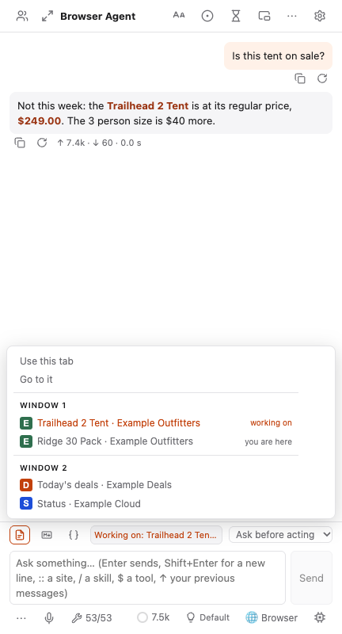

# Using the chat

## What goes with each message

Every message carries, besides what you type, a **page block** with the active tab:

1. **Page details**: URL, title, language, viewport size and scroll position.
2. **Selected text**, if any.
3. **Visible elements**: what you can see and act on, written like a short Markdown page, each interactive
   element with a reference the model uses to act on it:

   ```text
   --- main ---
   # Open issues
   combobox "Status" [ref_k3x_7] value="Open"
   - ### [Login fails with SSO](/issues/PROJ-12) [ref_k3x_9] · In progress · button "Assign" [ref_k3x_10]
   navigation "pagination": [1](?page=1) [ref_k3x_16] · [2](?page=2) [ref_k3x_17] · [Next](?page=2) [ref_k3x_18]
   ```

The block is sent as **untrusted page content**: the model is told to treat it as data and never follow
instructions in it. Its size is capped by **Settings → Limits → Page block** (1,500 tokens by default); a part
that does not fit is cut, and the parts after it are left out with a note.

The **Page** button in the [page bar](#the-page-bar), above the message box, turns the page block on or off.
**Settings → Auto-inject** decides what else goes on its own: site memory, matching memory, site skills, site
templates, bookmarks and saved conversations. The ✨ menu in the top bar leaves any of them out of one conversation.

When you send a message from the window's side panel while you are on another tab than the chat's, the model is
also told that tab's id, title and URL, so that "this page" is not taken for the chat's; its tools still act on the
chat's tab. The model can also list the open tabs with `browser.list_tabs`: their titles and URLs, in the chat's
window or in every window.

When the model needs more than the visible elements, it uses the read tools: the whole page, its main text as
Markdown, a search for elements, structured data, a screenshot. See [Acting on pages](acting-on-pages.md).

## The page bar

The bar between the conversation and the message box shows the page the chat works on, what goes with your next
message, and what the agent may do there:

| Part | What it does |
|---|---|
| **Page** | Turns the page block on or off |
| **Show the chat as** | The chat's view: Markdown, Plain text, Jira markup, Layers or Diagrams ([Chat views](layers.md)) |
| **{ }** | *Show the conversation as sent to the model (JSON)*: the messages the next request carries, system prompt and page blocks included (not the tool definitions), with a copy button |
| The page | The site the chat works on; in the window's side panel and full screen, the tab picker (below) |
| Selection chip | How many characters you selected on the page, sent with your next message; click to leave them out (or send them again) |
| Site skill chips | The [site skills](skills.md) that go with this page; muted when they are not sent (the ✨ menu or **Settings → Auto-inject**) |
| Template chips | Each [site template](site-templates.md) matching the page, its view and how much it found (⚠ when nothing). Click for what it sends and its diagnosis, **Read again** or **Edit** |
| **Word blacklist** | Whether the [word blacklist](word-blacklist.md) applies to this chat; click to turn it on or off |
| **N page tools** | The tools the page offers through [WebMCP](webmcp.md); point at it for their names |
| Policy selector | The site's policy: **Ask before acting**, **Act without asking** or **Read only**. With an [agent](agents.md), what that agent may do on the site instead. Not in the chat floating on a page |
| **this conversation** | You allowed acting without asking on this site for this conversation; × asks again |
| **Allow** | The extension cannot read this site yet: click to allow it (*not accessible* on pages it never reads) |

### The tab picker

In the window's side panel and in the full-screen chat, the page's name opens the **tab picker**, the tabs you can
make the chat work on. When you are on another tab than the chat's, it reads **Working on:** and the chat's page.

<p align="center"></p>

- The open tabs, grouped by window (*Window 1*, *Window 2 (app)* for an installed app), each with its icon. The
  chat's tab is marked *working on*, yours *you are here*, and the browser's own pages *not accessible*. Choose one
  and the chat works on it.
- **Use this tab** makes the chat work on the tab you are on.
- **Go to it** brings the chat's tab to the front of its window.

The icons come from the browser's own cache: the site is not asked for them. The chat floating on a page, a tab's
own panel and the [agent manager](agent-manager.md)'s chats keep their tab.

## Models and thinking

- The **model picker** next to the message box lists the last models you picked under **Recent**, then the
  models of every provider: those registered in **Settings → Providers → Models in the picker**, or all its
  `/models` when none is (see [Choosing a model](providers.md#choosing-a-model)). Type any model id and press
  Enter to use one that is not listed.
- The **thinking** selector sends a reasoning level: *Default (the server decides)*, *Off*, *Low*, *Medium* or
  *High*. It is saved per provider and model. How it is sent depends on the server; see
  [Providers and models](providers.md#thinking-and-reasoning).
- The model's reasoning is shown above its answer (**Settings → Appearance → Reasoning**: collapsed, expanded or
  hidden).
- The context meter shows how much of the model's window the conversation takes, and offers **Compact now**.

## Messages

- **Under your message**: copy it, or **Regenerate from here**: send it again (the page is read again) and drop what
  came after.
- **Under an answer**: copy it (as Markdown, or Jira markup in that view), or **Regenerate** it. The agent that
  answered is named when it is not Browser.
- **Tool calls** show as a row each: the tool, ✓ or *error*, the tab it ran on, and **DevTools** when it ran on the
  [DevTools engine](devtools-engine.md). The **args** and **result** (or **error**) switches open the arguments and
  the result; a screenshot shows as a thumbnail that opens it. **Settings → Appearance → Tool calls** sets whether the
  rows start collapsed, expanded or compact; [Settings → Display](appearance.md#display) what each row and the row
  under an answer show.
- **↑** on the first line of the message box brings back your earlier messages of the conversation; **↓** goes forward
  to your draft. Edit one and send it again.

**While the agent works**, the line under the conversation names what it is doing and for how long (*Reading the
page… 1.2 s*, *Waiting for the first token… 3.4 s*, a tool's name while it runs) until the answer streams in. In
[Layers](layers.md#phases-of-the-turn) the line lists every phase of the turn instead, each with its time.

While it works the button reads **Stop**. Enter **queues** what you type (up to 3 messages, text only): each
is sent when a turn ends. In the *Queued* strip, click one to edit it, ▶ to stop the agent and send it now, or ✕ to
remove it. **Ctrl+Enter** (⌘+Enter on a Mac) stops the agent and sends the box at once. Queued messages come back to
the box if the run is stopped or fails.

In the message box: **Enter** sends, **Shift+Enter** adds a line, `::`, `/`, `$`, `#` and `b::` start a
[mention](mentions.md), and **Tab** or **Enter** accept a suggestion.

## Settings → Auto-inject

**Settings → Auto-inject** gathers in one place what goes with a message without you mentioning it. Each switch is
the same as on its own page, which has the details (the match needed, how many). Under the title, three figures say
how many are on: **From the page**, **By a match** (and which also go between the model's steps) and **Mentions**.
Then four tabs, each a list of rows with a switch and a link to the row's own page:

**From the page** sends with each message what the page and its site have:

| Switch | Sends |
|---|---|
| **Page** | The active page: the same switch as the **Page** button |
| **Site memory** | The [memory](memory.md) items linked to the page's site, each once in a conversation |
| **Only those that match** (under Site memory, on) | Sends them whole only if pinned or if your message matches them, the others by title; off, all of them whole ([details](memory.md#memory-for-the-open-site)) |
| **Site skills** | The rules of the [skills](skills.md) for the page's site, with the first message there (then a reminder) |
| **Site templates** | What the [templates](site-templates.md) for the page's site read from it, with each message |

**By a match** attaches what your message matches well enough (auto-attach); the match needed and how many go are
on each one's **Matching** tab:

| Switch | Sends |
|---|---|
| **Matching memory** | The memory items your message matches, neither pinned nor linked to a site |
| **Bookmarks** | The [bookmarks](bookmarks.md) your message matches, once allowed there |
| **Saved conversations** | The [saved conversations](history.md#settings--history) your message matches |

Under matching memory and bookmarks, **Also between the model's steps** matches what the model writes before calling
a tool too (not its reasoning), and adds what matches after that tool's result: useful on long runs, where the model
turns to a subject your message did not name. The memory rows are greyed out while memory is off, saved conversations
while history is off, and a *between steps* row while its auto-attach is off.

**Mentions** holds the mentions you can write: untick one you never use, or whose sign you often type for other
things, and writing it attaches nothing. **Limits** holds the **Page block**, **Visible elements read from the page** and **Selected text**, the same values as in
[Limits](limits.md).

The ✨ menu in the top bar has the same rows under **In this conversation**: untick one to leave it out of this
conversation only, grouped as **Memory**, **Site** and **Saved**. **Match by meaning**, in Memory, stops sending your
messages to the embeddings provider in this conversation, and stays so when you come back to it. One switched off in
Settings shows *off in Settings*. **Every conversation** holds the **Page**
switch, which applies to all of them, and **Settings → Auto-inject…** opens the page. While something is left out, the
✨ icon is dimmed and its tooltip names what.

## The message box

- **Its height**: drag its top edge to make it taller (up to most of the window); the height stays while the chat is
  open. A double-click on the edge gives it back its own height, which grows with the text.
- **Its buttons**: when the panel is narrow, the buttons under the box that do not fit go behind **⋯**, starting from
  the left (the model picker, at the right end, always stays); **⋯** shows them on a row of their own, where they work
  as usual.

## When the agent waits for you

A card that waits for you (an action to confirm, site access, a question, a sign-in, an element to pick, a sub-agent
out of steps), the step limit, a recording to review, or an agent of the [Agents Panel](agent-manager.md) waiting can
also tell you while the chat is **not in view**: the side panel closed, its tab or window in the background, the
floating chat folded, the Agents Panel's tab not the one shown. **Settings → Alerts** sets, for each, how:

- **Silent**: nothing; the chat shows it when you open it.
- **Badge**: **!** on the extension's toolbar icon until nothing waits any more (over a recording's count, a tab's
  audio or DBG).
- **Notify**: the badge, and a system notification. Clicking it shows the chat's tab (and its side panel, when the
  browser lets a notification's click open it).

By default what stops a run until you answer notifies, and the sub-agent out of steps, the step limit and a recording
to review mark the badge. Never with a sound. Answering (or Stop) clears the alert; the step limit's clears once the chat
shows. A level only changes how you are told: the cards ask as they always do.

## More about the chat

- [Where the chat opens](chat-windows.md): side panel, floating, full screen, following you across tabs.
- [Mentions](mentions.md) and [attachments](attachments.md).
- [Chat views, Layers and the context meter](layers.md).
- [Appearance](appearance.md) and [voice dictation](voice.md).
- [Saved conversations](history.md), including temporary ones.
