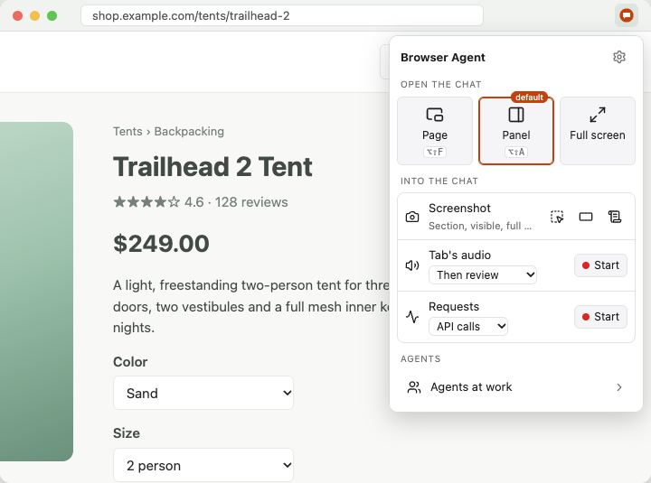

# Getting started

This page takes you from nothing to your first conversation about a web page.

## 1. Install the extension

Teseo runs in Chrome or another Chromium browser with side panels (Vivaldi, Edge, Brave…). Firefox is not
supported (a trial build lacks some features). Each [release](https://github.com/aseth0/teseo-browser-agent/releases)
offers three versions; **Settings → About** shows what yours has
([what each version has](settings.md#what-each-version-has)).

| Version | For | Leaves out |
|---|---|---|
| [The downloadable version](#the-downloadable-version), `teseo-browser-agent-X.Y.Z-chrome.zip` | Everyone: every feature | Nothing, but it does not update itself |
| [The Chrome Web Store version](#the-chrome-web-store-version), `teseo-browser-agent-X.Y.Z-chrome-store.zip` | The same build submitted to the Chrome Web Store | The [DevTools engine](devtools-engine.md) and the [sources of custom tools](custom-tools.md#sources-tools-shared-by-a-team); its settings are its own |
| [From source](#from-source) | Development | Nothing: you build it |

### The downloadable version

1. Get the extension's folder, either way:
   - **A release zip**: download `teseo-browser-agent-X.Y.Z-chrome.zip` from the
     [releases page](https://github.com/aseth0/teseo-browser-agent/releases) and unzip it.
   - **The `dist` branch**, the same build unzipped, always the latest version, updated with `git pull`:
     ```bash
     git clone --branch dist --single-branch https://github.com/aseth0/teseo-browser-agent.git teseo-browser-agent-dist
     ```
2. Open `chrome://extensions` (`vivaldi://extensions` in Vivaldi, `edge://extensions` in Edge) and turn on
   **Developer mode**.
3. Click **Load unpacked** and choose the folder.
4. Pin the icon: puzzle menu 🧩 → 📌.

**Updating.** It does not update itself. Replace the folder's contents with the next release's (or `git pull` in
the clone) and click ↻ on the extension's card. Do not remove the extension to update it: removing it deletes its
settings, conversations and keys.

**Its id is always the same.** The manifest carries a key that fixes the extension's id, so it is the same on any
computer and from any folder: move or replace the folder and your settings stay. A build
[from source](#from-source) has that same id.

### The Chrome Web Store version

The build submitted to the Chrome Web Store: without the browser's debugger permission, so without the
[DevTools engine](devtools-engine.md), and without the
[sources of custom tools](custom-tools.md#sources-tools-shared-by-a-team). Where Teseo is listed in the store, install it from there and the store
keeps it updated. Otherwise, download `teseo-browser-agent-X.Y.Z-chrome-store.zip` from the
[releases page](https://github.com/aseth0/teseo-browser-agent/releases), unzip it and load it unpacked as above.

**Its id is not the downloadable version's**, so its settings, conversations and keys are separate: moving from
one to the other starts from empty settings (Settings → Export and import carries them over; keys are typed again).
- Installed from the store, the store gives it one id, the same for everyone, and keeps it.
- Loaded unpacked from the zip, its manifest carries no key (the store refuses one), so the browser makes the id
  from the folder's path: the same folder keeps the id, and loading it from another folder, or on another
  computer under another path, is a new extension with empty settings. To use Teseo unpacked day to day, take the
  downloadable version.

### From source

For development: clone the repository (at a release's tag `vX.Y.Z`, or the default branch), then `pnpm install`
and `pnpm build`, and load `dist/chrome-mv3` unpacked. See
[Building from source](../../CONTRIBUTING.md#building-from-source).

## 2. Connect a model

Teseo talks to any server with an OpenAI-compatible `/chat/completions` endpoint.

1. Click the toolbar icon → ⚙ **Settings** → **Providers**.
2. **＋ Add provider…** and pick a preset, or start from one and change it:

   | Preset | Base URL |
   |---|---|
   | OpenAI | `https://api.openai.com/v1` |
   | OpenRouter | `https://openrouter.ai/api/v1` |
   | Groq | `https://api.groq.com/openai/v1` |
   | Ollama (local) | `http://localhost:11434/v1` |
   | LM Studio (local) | `http://localhost:1234/v1` |

3. Fill in the **API key** (not needed for local servers) and a **Default model**.
4. Click **Test connection**. The browser asks once to allow the extension to reach that server. "OK · N models"
   means it works.

For Ollama, start it so that it accepts the extension's requests:

```bash
OLLAMA_ORIGINS='chrome-extension://*' ollama serve
```

More in [Providers and models](providers.md).

## 3. Open the chat

The toolbar icon opens a small popup, **Open the chat**, with three ways to open it (point at one for its full
name):

<p align="center"></p>

- **Page**: the chat floating on the page itself.
- **Panel**: the chat in the side panel, next to the page, the usual way.
- **Full screen**: the chat full screen in a tab of its own.

Below them, **Screenshot** takes a screenshot of the page into the chat, ready to ask about: **Section** (drag over
a part), **Visible** (what you see) or **Full page** (the whole page, top to bottom). **Tab's audio** captures what the tab
plays, to save it, review its transcript or put it in the chat ([A tab's audio](tab-audio.md)). **Requests** records the
calls the page makes while you use it ([Recording a page's requests](recordings.md)). Then **Agents Panel** opens the agent
manager: several agents at once, each on its own tab. The ⚙ at the top right opens **Settings**.

Keyboard shortcuts (change them on the browser's shortcuts page, `chrome://extensions/shortcuts`, or give each
action a key of its own in **Settings → Shortcuts**: [keys set in Settings](chat-windows.md#keys-set-in-settings)):

| Shortcut | Does |
|---|---|
| **Alt+Shift+A** | Opens the side panel |
| **Alt+Shift+F** | Opens or folds the chat floating on the page |
| **Alt+Shift+W** | Shows or hides the page widget on this site |
| **Alt+Shift+S** | Screenshots the visible part of the page into the chat |

The others (a section or the whole page, a tab's audio, recording) have no key until you set one.

In the side panel's top bar, **Open in a tab** opens the same chat full screen in a tab.

## 4. Your first conversation

Open any web page and ask about it:

- *"Summarize this page in five bullet points."*
- *"Which of these products is the cheapest with free shipping?"*
- *"Find the contact form and fill it in with: …"*

The first time on a site, the chat asks to **Allow reading** it: the extension reads only the sites you allow
(or every site, if you choose so in **Settings → Website access**).

When the model wants to change something on the page (click, type, choose, navigate), a card asks you first:

- **Allow**: this time.
- **Allow on *site* ▾**: for the rest of **this conversation**, or **always** (the site's policy becomes *Act
  without asking*).
- **Deny**, with an optional comment for the model.

The selector under the conversation shows the site's policy and changes it: **Ask before acting**, **Act
without asking** or **Read only**. See [Acting on pages](acting-on-pages.md).

## Next steps

- [Using the chat](chat.md): mentions, attachments, models and thinking levels.
- [Agents](agents.md): give a task its own tools, sites and model.
- [Skills](skills.md): teach it a task once.
- [Privacy and security](privacy-and-security.md): what is sent, and where.
- [How-to guides](../howto/README.md): step-by-step guides for common tasks.
- [Troubleshooting](troubleshooting.md): when something does not work.
