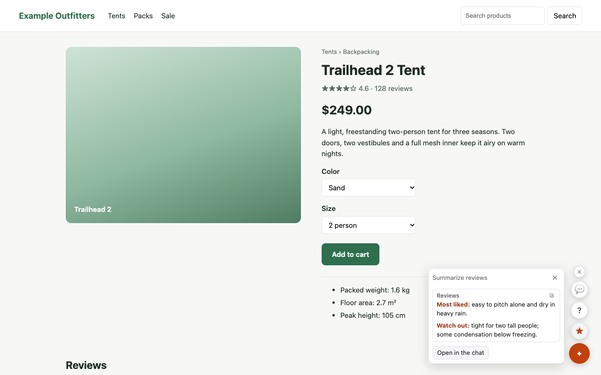
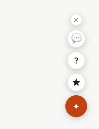

# The page widget

The **page widget** is a small bubble on the pages you choose, with buttons (**actions**) that run a tool, ask the
model, or both, and show the answer in a card on the page. No chat needed.

Manage actions in **Settings → Actions**; the bubble's look and where it shows in **Settings → Bubble**.
**Alt+Shift+W** shows or hides it on the current site. On a site where it is hidden nothing of the
bubble runs, not even its actions on page load, until you show it again (the shortcut, **Show** in
Settings → Bubble, or floating the chat on the page).

## An action

| Part | |
|---|---|
| **Name** and **icon** | The button |
| **Websites** | URL patterns where it shows; none: every site you granted |
| **Agent** | *Browser*, or one of your [agents](agents.md): then it uses only its tools, and shows only on its sites |
| **When it runs** | On a click, or **on page load** (tools that read, nothing typed; with [steps](#steps), the model too) |
| **What it does** | Shows its answer in a card, or opens the chat with a message |
| **What it takes** | A text (pre-filled with the selection), the selected text, or nothing |
| **Show beside selected text** | Off, but on for a new *Answer about the selection*. A button for it next to the speaker when you select text on its sites ([below](#beside-the-selected-text)) |
| **Tool** | One tool and its arguments, with `{input}` for what it takes |
| **Prompt** | Optional: the model answers too, only when you click, with its own model and thinking level |
| **Values from the page** | `{{page}}`, `{{selector:…}}`, `{{meta:…}}`, `{{schema:…}}`, `{{url}}`, used as `{name}` ([below](#values-from-the-page)) |
| **Boxes** | The answer, in labeled boxes: a path into the tool's answer, each line written and linked by a template |
| **Badge** | With [steps](#steps), on page load: a number, ✓ or ✗ shown on the bubble |

### Examples

- **Search the selection elsewhere**: input *selected text*, an HTTP tool, a box listing the results with links.
- **Translate**: input *selected text*, prompt *"Translate to Spanish: {input}"*, one box.
- **Summarize this article**: input *nothing*, a value read from the page (`article` = `{{page}}`), a prompt
  *"Summarize in three bullet points: {article}"*.
- **Summarize the reviews**: the same with `{{selector:section.reviews}}`, which reads only that part of the page
  (its first 1,000 characters).
- **Open issues for this project, as the page loads**: *on page load*, a tool that reads, a badge with the count.

### Values from the page

What an action reads from the page when it runs, each under a name its tool's parameters and its prompt use as
`{name}`:

| Value | What it reads | Size |
|---|---|---|
| `{{page}}` | The page's main text as Markdown, as `browser.get_page_text` reads it (Readability) | **Settings → Limits → Page text for a page widget action** (10,000 characters; also in this section's **Limits** tab) |
| `{{selector:css}}`, `{{selector:css?attr}}` | The text, or an attribute, of the elements a CSS selector matches | 1,000 characters |
| `{{meta:name}}` | A `<meta>` by name or property | 1,000 characters |
| `{{schema:@Type:path}}` | A schema.org JSON-LD value | 1,000 characters |
| `{{url}}` | The page's address | 1,000 characters |

The selected text an action takes is cut to 1,000 characters too; a text typed in its card, to 20,000. The values
go to the model as page content, apart from your prompt, as untrusted. Its tool can also be
`browser.get_page_text`: its answer then goes with the prompt, cut at **Settings → Limits → Page text**.

### Beside the selected text

An action that takes a text or the selected text, on a click, can also show **beside the selected text**: tick
**Show beside selected text** in the **What it takes** step of its editor. When you select text on a page where the bubble
shows, the small 🔊 under the selection becomes a toolbar: 🔊, a thin line, then the icons of those actions (their
name on hover). Up to four show as buttons; the others are behind **…**, a short list with their names (one that
opens the chat says so). Pressing a button keeps your selection.

An action runs at once with the selection, as from the bubble (a text action keeps its field above the answer, to
change it and run it again), and its card opens under the toolbar, next to the selection: the same card as the
bubble's, with its boxes, their 🔊, the reasoning folded and the buttons to go on in the chat. Near the bottom of the
window it opens above the toolbar; it always stays inside the window. An action that opens the chat opens it, as from
the bubble. The card closes with **Esc**, its ✕, or when the selection goes or you select something else: what it
runs stops and its boxes waiting to be read are dropped. Clicking in the card or typing in its field does not close it.

The toolbar shows the same actions the bubble would on that page (its websites, its agent's sites), never those on
page load. With **Settings → Speak → Reading → Button beside a selection** off, it has the actions without 🔊; with no
action marked, it is the 🔊 alone, as before.

### Steps

Instead of one tool and one prompt, an action can run **steps**, each named, each using what the earlier ones gave
as `{name.path}`:

1. **read** a value from the page, optionally cut by a regular expression (`/browse/(?<id>[A-Z]+-\d+)`);
2. run a **tool** (once, or once per item of a list, up to 20);
3. ask the **model**, optionally for a JSON answer with typed fields (`priority: High | Medium | Low`).

The boxes and the badge then take their values from any step.

### Reading a box aloud

Each box of text in a card has a 🔊 button beside Copy: it reads that box aloud with [Speak](speak.md), with the
action's voice, and turns into Stop while it reads. Another box's 🔊 takes its place; the pill on the page
stops it too. A box that lists links has none. Without a voice profile, the system's voice reads, unless **Settings →
Speak → Reading → System voice** is off: then the 🔊 is crossed out and says what to add. **Settings → Speak →
Reading → Button on action boxes** turns the buttons off.

An action's editor sets, in **Reading aloud**:

| Setting | Default |
|---|---|
| **Voice** | *As its agent*: the voice profile of the action's agent, else Speak's default profile, else the system's voice. Or one of your profiles, whatever its agent's; one removed later reads as *As its agent* |
| **When its boxes are read** | *When you click 🔊 on a box*. Or *On their own*: as soon as its answer is complete in the card; for an action that runs on page load, when you open its card |

On their own, an answer that streams into the card (the model's whole answer, in one box) is read as it is written,
from its first piece (Settings → Speak → **First piece**), as [the chat's](speak.md#answers-read-on-their-own) are;
an answer in several boxes (JSON) is read once complete. Its boxes of text are read one after another, in order, each waiting for the reading before it to end
(another box's, an answer's): they never cut what is being read. The pill says how many wait, and a box that waits
has a dashed 🔊 that reads it at once. Closing the card, or opening another action's, drops its boxes that still
wait; the one being read goes on until it ends or you stop it. They are read with **Button on action boxes** off too.
Closing the card while it streams: what is being read goes on to its last whole sentence. An action that opens the chat has no **Reading aloud**: its answer is
read as the chat's ([Answers read on their own](speak.md#answers-read-on-their-own)).

**Buttons to go on in the chat** adds two buttons to its card: 💬 goes on in the chat floating on the page, ◨ in the
side panel. The conversation starts from the card's answer, with the steps' values.

## Who makes actions

- **You**, in Settings → Actions, any action.
- **The model**, with `actions.save`, when you ask for a button: only actions that **read**. It tries the action
  with a sample first, and you review it before it is saved. Actions that change things are made by you.

Actions can be exported and imported as JSON, all of them or those you choose with **Select**
([Backups](settings.md#backups)); imported ones arrive switched off.

## The bubble

**Settings → Bubble** has the layout of the other sections: **Show the page widget**, beside its title, shows it on the
pages its actions match; three figures say where it shows, what it looks like and where it opens the chat. Then five
tabs:

- **Look**: an icon, a shape with eyes, mouth and hat, or your own SVG (cleaned of scripts and links), its color, and
  what it does while it works, with the bubble beside them as pages show it.
- **Actions**: how its actions unfold ([below](#actions-look)).
- **Where it shows**: **On every website** (on by default) shows the bubble on the other sites too, without actions:
  there a click opens the chat. The browser lets it show only where the extension has access, so until you give it
  every site, **Allow every site** asks for it. Its shortcut, and the sites it was hidden on, each with **Show**.
- **Opening the chat**: the side panel or floating on the page, and how the floating chat starts on a site. Its 📌
  keeps one conversation in the floating chat of every tab ([A conversation on every page](chat-windows.md#a-conversation-on-every-page)).
- **Shortcuts**: the bubble's, the floating chat's and the side panel's.

## Bubble look

In **Settings → Bubble → Look**, **Look** chooses one of three, with the bubble shown beside them as pages show it:

- **Icon**: ✦ by default; the button opens a grid of icons, with **Find an icon…** to search them by name.
- **Shape**: a body (Orb, Blob, Cat, Ghost…) and, except for Dots and Bars, a **Face**: **Eyes**, **Mouth** and
  **Hat**, each or none, and **Cheeks**. **Follow the mouse pointer** makes eyes that can move look at the pointer on
  the page you are on (they stay still if your system asks for reduced motion). **Surprise me** picks a face at
  random.
- **Your SVG**: **Paste an SVG** and **Use it**, or **Or fetch it from a URL** and **Fetch** (access to that site is
  asked for this download only); **Fetch again** gets it anew from the same URL, **Remove** drops it. It is kept as a
  copy, never loaded from the web by the bubble: up to 16 KB, with scripts, links, styles and embedded images removed
  (the page lists what was). Parts painted with `currentColor` take the theme's color. **Without the round
  background** shows the drawing alone.

**Color** is the **Theme accent** (the default) or an **Own color**. **While it works** chooses how the bubble shows
that the folded floating chat is working: *Ring* (the default), *Pulse*, *Thought bubble*, *The face thinks* or
*None*; waiting for your approval and a new answer always show. A [saved theme](appearance.md#your-themes) keeps this
look too.

**Shortcut** shows the key that shows or hides the bubble on the site you are on; change it at
`chrome://extensions/shortcuts`, or set a key of your own in **Settings → Shortcuts**
([keys set in Settings](chat-windows.md#keys-set-in-settings)). **Hidden on** lists the sites where you hid the bubble with its ✕, each with **Show**
to bring it back. On those sites nothing of the bubble runs, not even its actions on page load, until
you show it again; a chat floating on the page when you hide it stays until you close it.

## Actions look

In **Settings → Bubble → Actions**, with the bubble and three sample actions unfolded beside them:

| Option | Choices | Default |
|---|---|---|
| **Shape** | Square, Rounded, Circle | Square |
| **Layout** | *Column* (above or below the bubble), *Row* (beside it), *Arc* (a quarter circle around it), *Ring* (a whole circle around it) | Column |
| **Shows** | Icon, or Icon and name | Icon |
| **Size** | Small (28 px), Medium (36 px), Large (44 px) | Large |

They unfold away from the nearest edges of the window: up from the lower half, left from the right half. A ring falls
back to an arc with more than 8 buttons (the actions, 💬 and ✕) or where the window has no room for it. Names show only
in a column; in the other layouts an action's name shows when you point at it. The card of an action opens beside the
bubble, past the actions unfolded on that side. A [saved theme](appearance.md#your-themes) keeps these choices too.

## The action editor

**Settings → Actions** says how many actions there are and are on, how many run on page load, with the model, and
whose tool is missing; its **Actions** tab lists them, **Texts** has the texts the model gets.

An action's editor is a guide, one step at a time, with only what that kind of action uses. A new action starts with
**What it does**, five choices, each with an example:

| Choice | What it sets |
|---|---|
| **Answer about the selection** | The model answers in a card; it takes the selected text and shows beside it |
| **Look it up with a tool** | One tool, its answer in boxes; it takes a text, pre-filled with the selection |
| **Open the chat with a message** | The chat opens with its message, sent at once; no tool, no boxes |
| **Check each page as it loads** | On page load, a tool that reads, nothing typed |
| **Several steps** | [Steps](#steps), on a click or on page load, with fields or a badge |

Or start from an example (*Explain the selection*, *Summarize the article*, *Ask the chat about this page*), which
fills every step. Then: **Where it shows** (its websites and agent), **What it takes** (the selected text, a text, or
nothing; **Show beside selected text**), **Values from the page** (optional: **Next** passes over it), **What it runs**
(the prompt or the message, the tool and its parameters, or the steps; a chip inserts `{input}` or a value from the
page where the cursor is), **How the answer shows** (its boxes), **Try it**, and last **Name and icon**, with a name
suggested from what it runs.

Each step done folds to a line, with **Change**; a step's problems show beside their fields once you have been
through it, and the **Checks** card counts what is left, each with a link to its step. Optional parts fold to a line
until you open them: a tool before the prompt, **Model and thinking**, **Reading aloud** (its voice, and whether its
boxes are read on their own: [Reading a box aloud](#reading-a-box-aloud)), and with steps the badge and **Buttons to go
on in the chat**. Folding a step or a part keeps what you typed. Choosing another kind, or an example, asks first when
the action has something it would replace, and says what; the steps that still apply (where it shows, what it
takes, its values, its name) stay done. On page load, its tool and its steps' tools are only tools that read. An action on page load shows a badge once it is made of steps: **Make it
steps**, under **How the answer shows**, turns its tool into the step `result`, its boxes and a badge taken from it.

An action that exists opens with every step folded to its line, as the kind its fields make it; saved untouched, it
stays exactly as it was. **On**, beside its name, shows it in the page widget or not.

**Try it** runs the action as it is, unsaved, with a value typed in for what it
takes, and shows its boxes and badge; the model's answer shows as it comes. A tool that changes something asks first,
as the card would. With steps:

- **The tab it runs on** chooses the open tab whose values are read and where its tools act;
- each step shows what it was given and what it gave, or why it stopped;
- **▶ Try up to here**, on a step, runs the action up to that step and shows its value whole, under the steps.

A **model** step lists **Tools it may call**: tick those it may use while it answers; one that changes things says
*(asks first)*. None ticked: it only answers.

**Thinking** sets how much the action's model reasons: *As in the chat* for that model (the default), or a level of
its own, among those its provider sends. Lower it for quick actions that must answer fast.
