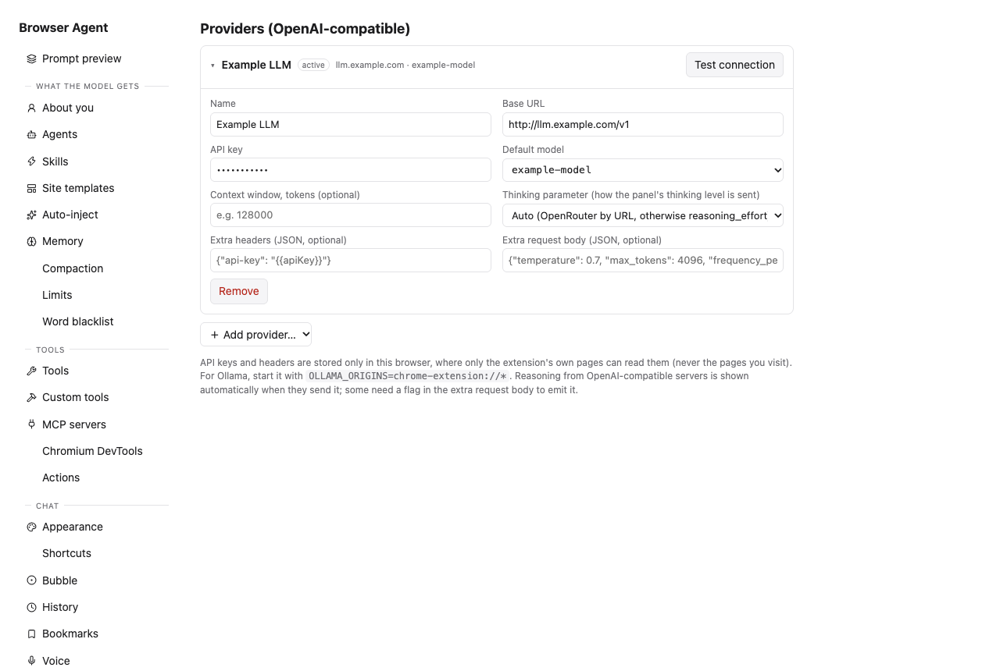

# Providers and models

Teseo works with any server that offers an **OpenAI-compatible** `/chat/completions` endpoint. Providers
are set up in **Settings → Providers**.

## Adding a provider

**＋ Add provider…** offers presets you can change afterwards:

| Preset | Base URL | Notes |
|---|---|---|
| OpenAI | `https://api.openai.com/v1` | |
| OpenRouter | `https://openrouter.ai/api/v1` | |
| Groq | `https://api.groq.com/openai/v1` | |
| Ollama (local) | `http://localhost:11434/v1` | Start it with `OLLAMA_ORIGINS='chrome-extension://*'` |
| LM Studio (local) | `http://localhost:1234/v1` | |

Any other compatible server works the same way: vLLM, SGLang, LiteLLM and other gateways.

Providers set up in another browser come over with [Settings → Export and import](settings.md#export-and-import),
without their keys: add each key here afterwards.

The section lists the providers on the left (the chat's marked *chat*), with **＋ Add provider…** under them, and
shows the one chosen on the right: its name, **Test connection** and **Remove** at the top, then its fields. Three
figures say how many there are (and how many lack a key), which one the chat uses, and how many answered a test.

<p align="center"></p>

Each provider has:

| Field | |
|---|---|
| **Name** | As shown in the model picker |
| **Base URL** | Up to and including `/v1`, usually |
| **API key** | Sent as `Authorization: Bearer <key>`, unless a header below uses `{{apiKey}}` |
| **Default model** | The model the chat starts with |
| **Models in the picker** | The models the model picker lists for it (below); none ticked, all of them |
| **Context window, tokens** | Optional, for servers that do not report one |
| **Thinking parameter** | How the chat's thinking level is sent (below) |
| **Extra headers** | A JSON object of headers sent with every request |
| **Extra request body** | A JSON object merged into every request |

**Test connection** asks the browser for permission to reach the server, then lists its models ("OK · N
models"). A server without `/models` is tested with a short chat to the default model.

### Local models

Small local models answer well about a page, but multi-step tasks with tools are harder for them:

- **Keep the tools few.** Every tool's definition goes with every request. Switch off the tools you do not use in
  **Settings → Tools**, and give a task an [agent](agents.md) with only the tools and sites it needs.
- **A plain chat.** With the built-in **EmptyAgent** the model gets only your messages: no tools, page or memory.
- **Thinking.** Reasoning models are slow locally: set the chat's thinking selector to *Off* or *Low* for simple tasks.
- **The context window.** If long pages seem forgotten, give the server a larger context length and set the
  provider's **Context window, tokens** to match. A smaller **Settings → Limits → Page block** also helps.

### Extra headers

For gateways that expect the key in another header, put `{{apiKey}}` where it goes; the `Authorization` header is
then not sent:

```json
{"api-key": "{{apiKey}}"}
```

### Extra request body

Merged into every request, on top of the extension's own fields (`max_tokens` included). Use it for sampling
settings or server flags:

```json
{"temperature": 0.7, "frequency_penalty": 0.3}
```

Some servers only return their reasoning when asked to, for example `{"reasoning_effort": "high"}`.

## Choosing a model

The **model picker** in the chat first lists **Recent**, the last five models you picked from any provider, and
then the models of every provider, grouped by provider. Type to filter, or type a model id that is not listed and
press Enter. [Agents](agents.md) and [page widget actions](page-widget.md) can use their own model.

A server may list hundreds of models. To see only those you use, tick them in **Settings → Providers → Models in
the picker**: its list comes from the server's `/models` (**↻ Refresh from provider** asks again), and an id it
does not list can be typed and registered with Enter. The picker then lists only the ticked models, plus the
provider's default model and the model in use, which are always listed. **Show all** next to the provider's name
lists the rest (**Show registered** goes back), and the filter always looks through all of them. With none
ticked, the picker lists all its models, as before. The model fields of agents, actions and compaction suggest
the default and ticked models, and still take any id. Exported providers keep their ticked models.

## Thinking and reasoning

The chat's **thinking** selector offers *Default (the server decides)*, *Off*, *Low*, *Medium* and *High*,
saved per provider and model. The provider's **Thinking parameter** says how it is sent:

| Option | Sends | For |
|---|---|---|
| **Auto** (default) | `reasoning: {effort}` for OpenRouter, `reasoning_effort` otherwise | Most servers |
| `reasoning_effort` | `"low"` … `"high"`; Off as `"none"` | OpenAI, LiteLLM, Groq, Ollama, LM Studio |
| `reasoning: { effort }` | Off as `{enabled: false}` | OpenRouter |
| `chat_template_kwargs.enable_thinking` | On or off only | vLLM, SGLang |
| **None** | Nothing; the selector is hidden | Servers that reject the setting |

If a server answers *400* with an error about reasoning or thinking, the request is sent again without it.

The model's reasoning is shown when the server sends it, in any of the usual forms: `reasoning_content`,
`reasoning`, `reasoning_details`, `thinking`, or `<think>…</think>` in the answer.

While the model works on your last message, each of its answers goes back to it in the next request with its
reasoning (the `reasoning` field of that assistant message): models that think between tool calls, such as
Qwen3, keep on from it instead of starting over, and call tools with fewer empty arguments. Answers to your
earlier messages go without theirs. A server that rejects the field (*400*) is asked again without it, and
remembered.

## A provider from the environment (personal builds)

When you [build from source](../../CONTRIBUTING.md#building-from-source) with `EXTERNAL_MODEL_API_KEY` set,
an **Environment** provider is added and selected, with `EXTERNAL_MODEL_BASE_URL` and `EXTERNAL_MODEL_NAME` as
its URL and model. The key is compiled into the extension's background worker only and kept with the other
secrets; it is never shown. Do not share such a build: the key is inside it. Published builds never contain one.

## Where keys are kept

API keys and extra headers are kept in the extension's own storage, which web pages and the extension's page
scripts cannot read. Each key is bound to the URL it was saved for: change a provider's Base URL and its key must
be typed again, so a key is never sent to a server it was not meant for. See
[Privacy and security](privacy-and-security.md).

## Troubleshooting

| Message | What to check |
|---|---|
| *Could not connect to … (DNS, VPN, untrusted certificate or server down)* | The URL, your network, a corporate certificate |
| *401 / 403* | The API key, or the header it goes in (Extra headers) |
| *404* | The Base URL: missing or extra `/v1`? |
| *The server does not list models* | Set a Default model to test the chat |
| Ollama refuses the request | Start it with `OLLAMA_ORIGINS='chrome-extension://*'` |
| No reasoning shown | The server may need a flag in the Extra request body |
