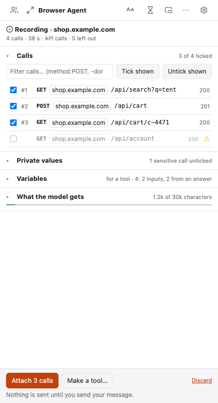
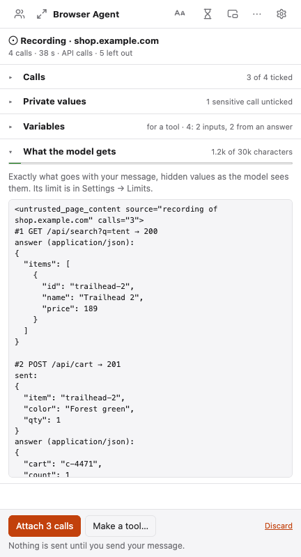

# Recording a page's requests

A recording keeps the API calls a page makes while **you** use it, to build a [custom tool](custom-tools.md) from
them or to show the model how a site works. Only you can start a recording, and nothing reaches the model before you
review it.

## Starting one

- **From the toolbar button**: the popup's **Requests** line. Pick a **Preset**, then **● Start** (this tab). With
  [the DevTools engine](devtools-engine.md) on, you can also pick **Several tabs** or **Tabs and mouse**, the icons before it, which keeps
  what you click and type too (never passwords, cards or codes).
- **With a shortcut**: *Start or stop recording the page's requests* has no key until you set one
  (**Settings → Shortcuts**). It records this tab with your default preset.

While it records, the toolbar icon shows the number of calls in red, and a small pill on the recorded page shows
*Recording · 3 calls · 0:42* with **Stop**. You can drag the pill aside. To stop it, click **Stop** on the pill or in
the popup, or press the shortcut again. The recording goes on if you close the chat.
It stops when you stop it, when the tab closes, or when it reaches 100 calls or its time limit (5 minutes at most).
A recording that cannot start (the site is not enabled, another debugger holds the tab…) leaves nothing behind: the
popup or a notification says why.

Without the DevTools engine, the extension sees what the browser tells about the tab's requests, and the answers of
the page's `fetch` and XHR calls. With the engine it sees everything, including Web Workers and WebSocket messages.

## Presets

**Settings → Recording** says how many presets there are and which one **Record** starts with. Its **Presets** tab
lists them on the left (the default one, built-in, edited or yours) and shows the one chosen on the right, as rows:
its name, **Use by default**, **Reset** (a built-in one edited) or **Delete** (one of yours), and what it keeps.
**＋ New preset** adds a copy of the one shown. **Shortcut and limits** has the recording's shortcut and **Recording of
requests sent with a message** (30,000 characters), the same as in [Shortcuts](chat-windows.md#keys-set-in-settings)
and [Limits](limits.md).

A preset decides what is kept as the calls come. Calls it leaves out are only counted: the review says *12 left out*,
and nothing else about them is kept.

| Preset | Keeps |
|---|---|
| **API calls** (the default) | `fetch`, XHR and WebSockets on any site; JSON and text answers; a call repeated with other values only once; leaves out addresses that look like analytics, tracking, pixels or ads |
| **Everything** | Every call but images, fonts, style sheets and media |
| **Errors only** | Calls that failed or got a 4xx or 5xx answer |

Change them, choose the default one or add your own in [**Settings → Recording**](settings.md). For each preset you
can choose:

- the kinds of calls kept (at least one: a preset without any would record nothing);
- every site, or only the recorded site and its subdomains;
- addresses to keep only, or to leave out, one per line. An address with a scheme is a match pattern
  (`*://*.example.com/api/*`). Without one, `*` stands for anything in the host, path and query: `*analytics*` leaves
  out any address that contains "analytics", and `*/collect` only one that ends that way;
- the methods (GET, POST…), the status (all, errors, success), the answers (all, or JSON and text only);
- whether a call repeated with other values is kept only once;
- how much of each body is kept (20,000 characters at most) and when it stops (5 minutes at most).

No preset can keep more than a recording always does: header values and cookies are never kept, and values under
secret-looking keys are hidden as they arrive, in the whole body before it is cut to the preset's size: in JSON, in
forms (`a=1&b=2` and multipart, by each part's name), and in JSON sent line by line (NDJSON, the `data:` lines of
server-sent events). Without the DevTools engine, the page's answers are read whole up to 200,000 characters; a
JSON answer longer than that cannot be checked, so it shows only as `(JSON, over 200000 characters: too large to
check for secrets)`.

**Compressed and binary bodies.** A page may send what it posts compressed, as large JSON APIs often do. The recording
unpacks it first (gzip and deflate; Brotli only where the browser can), so the review and the model see the JSON,
its secret-looking values hidden as in any other body. Without the DevTools engine the browser does not tell which
compression a request used, so only gzip and deflate are recognised, by their first bytes. Answers come unpacked by
the browser already. A body that is not text (an image, protobuf, a file) shows only its size, as
`(binary, 1234 bytes)`, never as garbled characters. One that cannot be unpacked says why, and none of it is kept:
`(br, 1234 bytes: cannot be unpacked here)`, or `(gzip, 1234 bytes: too large to unpack)` past 1 MB unpacked.

## The review

When you stop the recording, the review opens in the chat: in the chat floating on that page if it is open, otherwise
in the side panel. A recording that stopped by itself waits in the chat that is open, or in the toolbar popup
(**Recorded · 14 calls**, with **Review** and **Discard**). It waits at most 30 minutes: past that it is discarded,
so that its bodies do not stay in the browser's session storage. While it waits and the chat is not in view, the
toolbar icon shows **!** (or a notification, as **Settings → Alerts** says: [When the agent waits for you](chat.md#when-the-agent-waits-for-you)).



Its head says the site, then how many calls, how long, the preset and how many it left out. Below, each section says
where it stands even when folded:

- **Calls** (*3 of 4 ticked*): tick the calls to keep; those marked ⚠ start unticked. ⚠ means a value looks
  sensitive: under a secret-looking key, or a card number, an email, a phone number or a long token; the same kind
  under the same key is listed once, with how many (`a phone number (answer: rows[].tel) ×8`). A body that is
  neither JSON nor a form (XML, say) but has named fields (`name="…"`) cannot be checked: it is marked ⚠ too, for
  you to read before ticking the call, or to hide whole. An IP address, and a
  call that sends your sign-in headers, only get a note (ⓘ): such a call starts ticked, and you can still hide the
  address yourself. The ticked ones carry the numbers the model gets (#1, #2…). Open a call to see what it sent and
  the answer it got, and its **Values**.
- **Private values** (*⚠ 1 ticked call looks sensitive · 2 hidden*): the values you hid, each with × to show it
  again. To hide one, select it in a call and click **Hide selected value**, or click **Hide…** next to it in the
  call's **Values**. The model then sees `••••`, or `••••[name]` when you name it. **Save it for a tool** keeps the
  value in the extension, sent later only to the same site, as `{{secret:name}}`.
- **What the model gets** (*6.2k of 30k characters*): exactly the text that goes with your message, hidden values as
  the model sees them, and its size against **Settings → [Limits](limits.md)**. Past the limit, it says how many
  calls go without their bodies.



At the bottom, always in view:

- **Attach 3 calls** adds the recording to your next message, as a chip by the message box
  (*Recording · 3 calls · shop.example.com · 6.2k chars*). Click the chip to review it again, × to leave it out.
- **Make a tool…** first shows [what changes each time the tool runs](#what-changes-each-run), then attaches it
  too and fills the message box with a request for a tool that makes these calls
  (see [the how-to](../howto/tool-from-a-recording.md)).
- **Discard** throws it away.

Nothing is sent until you send your message.

### What changes each run

**Make a tool…** opens a step of its own (a recording with no such values skips it). At its top, the calls you
ticked with their numbers; below, the values that change between runs, each with a name you can change and what
happens to it when the tool runs:

| Kind | When the tool runs |
|---|---|
| **You give it each time** | It is an input of the tool, like a search term |
| **From #1's answer** | The tool takes it from that call's answer, like an id |
| **Worked out (+1)** | One more than a number an answer gave, like a page's next version |
| **Always as recorded** | It goes as it was recorded |

Each one also says where it comes from and where it is used. Only these choices go to the model, with
**Make the tool**: **Attach** sends the recording without them. **Back** returns to the review.

For example, you search a shop for *oak chair*, open the product found and save it:

```
#1 GET /api/search?q=oak+chair       answer {"items":[{"id":"p-8812"}]}
#2 GET /api/products/p-8812          answer {"version":{"number":7}}
#3 PUT /api/products/p-8812          sends  {"version":{"number":8}}
```

The step shows three values:

| Name | Value | Kind | Says |
|---|---|---|---|
| `q` | oak chair | You give it each time | used in #1 query q |
| `itemsId` | p-8812 | From #1's answer | from #1 items[0].id · used in #2, #3 URL |
| `versionNumber` | 8 | Worked out (+1) | #2 version.number (7) + 1 · used in #3 sent version.number |

The model is then asked for a tool that takes only the search term: it finds the product's id in the search's
answer, reads its version and saves it with the next one. Rename `itemsId` to `productId` if you like: the model
gets your names.

A recording that stops while the chat reviews another waits (up to 30 minutes): a band under the review's head says
so, and it opens once you finish the one you are on. Nothing you ticked or hid is lost.

The **Filter calls…** box also understands the words of the browser's Network panel. Several words must all match,
and a leading `-` turns any of them around. One still being typed (`domain:`, `larger-than:1.`) filters nothing until
it is complete:

| Type | Shows |
|---|---|
| `method:POST` | Calls of that method |
| `status-code:404` | Calls with that status |
| `domain:*.example.com`, `-domain:cdn.example.net` | Calls to that host, or every call but those |
| `mime-type:application/json` | Answers of that type |
| `larger-than:10k` | Answers longer than that, in characters (`k` = 1,024 and `m` = 1,048,576, as in DevTools) |
