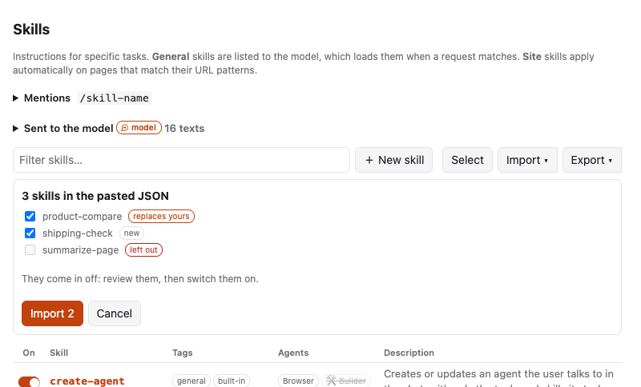

# Settings reference

Open Settings with ⚙ at the top right of the toolbar icon's popup, or ⚙ in the chat. Sections, in the order the
Settings page lists them:

| Section | What it sets | Guide |
|---|---|---|
| **Prompt preview** | Your system prompt; every fixed text sent to the model, editable; previews of a request, as any agent | [Your prompt](prompt.md#prompt-preview) |
| ***What the model gets*** | | |
| About you | A text about you, inserted where `{{about_user}}` appears | [About you](prompt.md#about-you) |
| Agents | Agent profiles; Builder; who can ask whom | [Agents](agents.md) |
| Compaction | When and how conversations are shortened; what is not sent again | [Compaction](compaction.md#settings--compaction) |
| Limits | Every size and time limit | [Limits](limits.md) |
| Word blacklist | Terms masked before anything reaches the model, and where | [Word blacklist](word-blacklist.md#settings) |
| ***RAG*** | | |
| Auto-inject | What goes with a message on its own; which mentions work | [Settings → Auto-inject](chat.md#settings--auto-inject) |
| Memory | Memory items, semantic search, auto-attach, the model's search | [Memory](memory.md#settings--memory) |
| Skills | Built-in and your own skills | [Skills](skills.md) |
| Site templates | Data extracted from websites | [Site templates](site-templates.md) |
| Bookmarks | Bookmarks permission, the folder the model sees, auto-attach | [Bookmarks](bookmarks.md) |
| History | Saving, retention, auto-attach, export and import | [Saved conversations](history.md#settings--history) |
| ***Tools*** | | |
| Tools | Tools offered to the model, their descriptions, which reach it for a message (matching), tools on demand | [Tools](tools.md) |
| Custom tools | Your own tools: shortcuts, HTTP requests, scripts; sources | [Custom tools](custom-tools.md) |
| MCP servers | Remote MCP servers, their sign-in, trust, when their tools are offered, and connection logs | [MCP servers](mcp.md) |
| Chromium DevTools | Real input and any-tab screenshots; more fields to mask | [The DevTools engine](devtools-engine.md) |
| Recording | The presets a recording of a page's requests keeps calls by, and the default one | [Recording a page's requests](recordings.md#presets) |
| Actions | The page widget's buttons, tried before saving | [Page widget](page-widget.md#an-action), [The action editor](page-widget.md#the-action-editor) |
| ***Chat*** | | |
| Appearance | Text size, how steps and reasoning show, themes, fonts, Layers, what the popup shows | [Appearance](appearance.md) |
| Display | What each tool call and answer shows: arguments as JSON or fields, the screenshot thumbnail, the tab chip, the tokens line…; what is always shown | [Display](appearance.md#display) |
| Shortcuts | Each action with its browser shortcut (**Open the browser's shortcuts page** changes those) and a key of its own, recorded here, for the websites the extension may read and its own pages | [Where the chat opens](chat-windows.md), [Keys set in Settings](chat-windows.md#keys-set-in-settings) |
| Bubble | The page widget's bubble and its look, where it opens the chat, the floating chat's size | [Bubble look](page-widget.md#bubble-look), [Where the chat opens](chat-windows.md#floating-on-the-page) |
| ***Audio*** | | |
| Voice | Audio model, microphone, language for dictation and a tab's audio; that audio's shortcut and limits | [Voice dictation](voice.md), [A tab's audio](tab-audio.md) |
| Alerts | How each thing the agent waits for you on tells you while the chat is not in view: silent, the badge, or a notification | [When the agent waits for you](chat.md#when-the-agent-waits-for-you) |
| Speak | Voice profiles and their Test, the pieces read at a time, reading rules, pronunciations, the button beside a selection, its shortcut | [Speak](speak.md) |
| ***Connections and access*** | | |
| Providers | Model servers, keys, headers, thinking parameter | [Providers and models](providers.md) |
| Web search | Search engine, results, background tabs | [Web search](web-search.md#settings--web-search) |
| Website access | Sites the extension may read | [Acting on pages](acting-on-pages.md#1-which-sites-the-extension-may-read) |
| Site policies | What the model may do on each site, per agent | [Acting on pages](acting-on-pages.md#2-what-the-model-may-do-on-each-site) |
| Logs | The action log, filtered; export with the MCP logs | [The action log](action-log.md) |
| Export and import | One file with the parts you choose, and its import with a preview | [Export and import](#export-and-import) |
| ***Teseo*** | | |
| About | The version, links to the docs, releases and issues, whether a newer version is out and the switch for that check (the downloadable version), and what this version leaves out | [What each version has](#what-each-version-has) |

## The RAG sections

Memory, Skills, Site templates, Bookmarks and History (and Auto-inject, Compaction, Appearance, Display, Word blacklist, Limits, Tools, Custom tools, MCP servers, Chromium DevTools, Recording, Actions, Bubble, Voice, Speak, Alerts, Providers, Web search, Site policies, Logs and Export and import) share one layout: under the title, one sentence and the
section's main switch (**Use memory**, **Allowed**, **Save conversations**, **Compact on its own**); a strip of figures, with a bar against
its limit where it has one; then tabs. The list comes first, with chips over it that show only the items of a kind.
Where something is attached on its own, **Matching** holds each match needed on a card and, under them, a message
tried as you would send it. **Limits and texts** (or **Mentions and texts**) holds what other sections show at their top.

## The top of a section

Under a section's title (in a RAG section, in its **Limits and texts** tab), a box lists what belongs to it:

- **Shortcuts**: its actions, with the browser shortcut (**not set** until you set one on the browser's shortcuts
  page) and the key set in Settings (**In pages**: click it and press the keys). They are the same as in
  [Settings → Shortcuts](chat-windows.md#keys-set-in-settings).
- **✂ Limits**: the size and time limits that apply to it, each with its field, its range and ↺ once changed. They
  are the same values as in [Settings → Limits](limits.md); hover a row for what happens past it. **Tools** folds
  the limits of the browser tools under **more limits**.

| Section | Shortcuts | Limits |
|---|---|---|
| About you | | About you |
| Skills | | Site skill value, Records of a site skill list |
| Site templates | | Site template output, ::site mentions per message, Nested  (fixed) |
| Memory | | Pinned memory items, Memory index, Memory items for the open site sent in full |
| Compaction | | Conversation sent to be summarized |
| Tools | The three screenshots | Tool result, Images attached to a message, Attached image, Attached file; the browser tools' limits folded |
| Custom tools | | Steps and time of a script tool |
| Recording | Start or stop recording | Recording of requests sent with a message |
| Bubble | The page widget, the floating chat, the side panel | |
| Auto-inject | | Page block, Visible elements read from the page, Selected text |
| Voice | Start or stop capturing the tab's audio | Transcript of a tab's audio sent with a message, How long a tab's audio is captured |
| History | | Saved conversation attached |
| Web search | | Page text |

A section's own texts sent to the model are in the tinted **Sent to the model** box near its top: the same
texts as in Prompt preview. Those of `tools.load`, in Settings → Tools, are listed only there.

## Export and import

**Settings → Export and import** moves your setup to another browser, or keeps a copy of it, in one file:
`teseo-export-YYYY-MM-DD.json`.

- **Export**: a switch for each part, in the groups of the Settings menu, with how many there are: agents,
  skills, site templates, memory, the word blacklist, custom tools, MCP servers, actions, themes, conversations,
  providers and settings. Memory, the word blacklist and conversations start off: they may be personal, and
  conversations are large. **All** and **None** set every switch; **Download** saves the file, **Copy JSON**
  copies it.
- **Never in the file**: API keys, the values of headers (their names stay, so you know what to fill in), MCP
  sign-ins, the values of `{{secret:…}}`, and website access. Providers come with their address, models and
  options; the build's own provider stays out. **Settings** takes About you, the system prompt, the model texts,
  which tools are on, limits, compaction, appearance, the chat window, auto-inject, history, voice, web search,
  recording presets and logs, but nothing of this browser: the active provider, model and agent, the bookmark
  folder, the microphone.
- **Import**: drop the file, or **From file…**, **Paste JSON…** or **From URL…** (read as in the sections, below).
  Nothing changes yet: first it says when the file was exported and by which version, which parts it holds and
  which it does not, then each part with a switch and how many of its items are new, replace yours or are left
  out. **Choose which** opens a part to tick its items, with why each one left out is; under Settings, only those
  that differ from yours, with yours and the file's side by side. **Import** stores what is ticked.
- What comes in is as each section's own import brings it: skills, site templates, custom tools, actions, agents
  and MCP servers come in off; a name already here is replaced and keeps its id (memory and conversations: the
  same id); nothing is deleted. Settings whose History retention would then delete saved conversations say how many
  first, and import only once you confirm. A provider that replaces yours keeps your key; a new one has none, so add it in
  [Providers](providers.md). Sign in again to MCP servers that need it. Agents come in before the memory and
  actions that name them.
- A file of one section (a skills file, a theme, a word blacklist…) imports here too, as its one part; a file from
  a newer version says which parts it could not read.

The file is JSON: `{ "type": "teseo-export", "version": 1, "exportedAt", "app", "parts": { … }, "leftOut": [ … ] }`.
Each part holds exactly what that section's own Export writes, so a part copied out alone imports in its section.

## What each version has

Teseo comes in three versions. The **downloadable** one (the [releases](https://github.com/aseth0/teseo-browser-agent/releases),
or the `dist` branch) has every feature. The **Chrome Web Store** one leaves out the
[DevTools engine](devtools-engine.md), as the store's version does not ask for the browser's debugger permission,
and the [sources of custom tools](custom-tools.md#sources-tools-shared-by-a-team), as the store does not let an
extension keep code in sync with a file on a server.
The **Firefox** build, a trial, lacks what Firefox has no API for: the DevTools engine, [Speak](speak.md) and the
system voice, and [a tab's audio](tab-audio.md). It has no [chat floating on the page](chat-windows.md#floating-on-the-page)
either: Firefox gives an extension's page framed by a web page none of the APIs the chat needs, so what opens the
chat from a page opens it full screen in a tab there. Its sidebar is also one for the window, as in Vivaldi: the chat
cannot keep [a panel for each tab](chat-windows.md#the-side-panel). It also leaves out, by choice, the
[sources of custom tools](custom-tools.md#sources-tools-shared-by-a-team): Mozilla's add-on policies want an add-on
that loads no code from elsewhere to run. And it never runs in private windows: Teseo keeps what it reads in its
conversations, and nothing from a private window may be stored.

Nothing is hidden: a section that is not in your version stays in the menu with an **unavailable** mark and says why,
a control inside a working page shows greyed with the same mark (click it: why opens under it), a tool the version
lacks shows greyed in **Settings → Tools** and is never offered (a model that calls it anyway is told it is not in this
version), and **Settings → About** lists
what your version leaves out. Where the browser lacks it, or the Firefox build leaves it out, the notice links to the
docs page about it; where it is the store's choice, to the downloadable version. Your settings move between versions with
[Export and import](#export-and-import).

The downloadable version does not update itself, so it **checks for a new version**: the first time the toolbar
popup opens after the browser starts, one request to GitHub for the latest release of its repository, with nothing
of yours in it. A newer one shows in the popup, with a link to the releases, until you close it with × (a later
release shows it again), and in **Settings → About** for as long as yours is older. **Check for a new version** in
Settings → About turns it off: no request, no notice. The Chrome Web Store version (the store updates it), the
Firefox trial build and a build from source never check.

## Backups

Besides [Export and import](#export-and-import), most sections export and import their own JSON: memory, conversations, themes, the word blacklist, skills,
site templates, agents, custom tools, MCP servers, actions and Speak's voice profiles ([Speak](speak.md#exporting-and-importing-profiles)). Exports of tools and MCP servers leave header values
(and a custom tool's `{{secret:…}}` values) out unless you choose to include them.

The lists of skills, site templates, custom tools, actions, agents and memory share one toolbar:

- **Export ▾** downloads or copies as JSON all of them, those the filter shows, or **Choose which…**: it starts
  **Select**, a column of checkboxes and a bar with **Download** and **Copy JSON** for those selected, also the ones
  the filter hides (the bar says how many). Selecting is apart from each row's switch, which only says whether
  the model gets the item: an export takes items on or off alike. Built-in skills and site templates, Browser and
  EmptyAgent come with the extension and are not exported.
- **Import ▾** reads **From file…**, **Paste JSON…** or **From URL…** (one item or many). First it shows what
  the JSON holds: each item new, replacing yours of the same name (memory: the same id), or left out, with why;
  tick those to import and click **Import N**. They come in switched off.
- **From URL…** reads a raw file, such as
  `https://raw.githubusercontent.com/example/skills/main/skills.json`; a file's page on GitHub
  (`https://github.com/example/skills/blob/main/skills.json`) is read as its raw file. The browser asks once for
  access to that site only, and the file is read without your cookies. That access is the site's
  [Website access](acting-on-pages.md#1-which-sites-the-extension-may-read), the same the chat reads pages
  with: remove it there if you only wanted the file.
- A file of another list (say site templates pasted into Skills) is not read: the message says where it goes.
  Files exported by earlier versions import as before.
