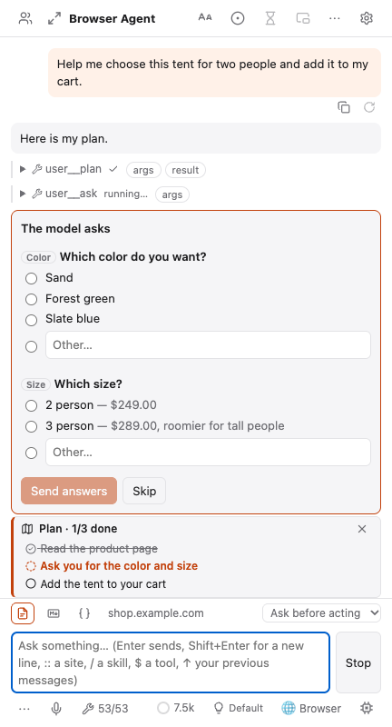

# When the model asks you

Some tools let the model involve you in the middle of a task, instead of guessing.

## Questions: `user.ask`

The model asks 1 to 4 questions in a card titled **The model asks**:

- **One choice** (radio buttons) or **several** (checkboxes), each with an **Other…** field for your own answer;
- **free text**.

**Send answers** once you have answered at least one; **Skip** dismisses the card and tells the model you skipped. The
chat keeps a one-line summary of your answers.

*"Which of these three flights should I book?"* · *"Ship to your home address or to the office?"*

## Pointing at something: `user.pick_element`

When it is easier to show than to describe, the model asks you to click an element. A banner on the page shows its
request (*Click the element you mean*), an outline follows your mouse, and your click selects the element instead of
activating it. Press **Esc** on the page, or **Cancel** in the chat, to give up. Only your own clicks count: the page
cannot pick for you.

## A plan: `user.plan`

For a task of several steps or phases, the model shows a plan and ticks it off as it goes. The latest plan is pinned
above the message box (*Plan · 2/5 done*), each step pending, in progress or done. Close it to hide it: it stays in the
conversation and stays closed when you reopen it, the model is no longer reminded of it, and the next plan shows it again. Once every step is done it goes when the turn ends. When the model has
made 8 tool calls without updating a plan with steps left, it is reminded of the plan (a *Plan reminder*
pill on that call), and again every 8 more; every 20 tool calls in the turn it is reminded even if it kept updating it.
Both numbers are in [Settings → Limits](limits.md). When it has gone 3 rounds in a turn without showing a plan, it is asked once
to show one if several steps remain, with the same pill. A plan with steps left stays known to the model after a
[compaction](compaction.md).

## Shortening the conversation: `chat.compact`

The model can ask to [compact](compaction.md) the conversation once the turn ends, saying what the summary must keep.
