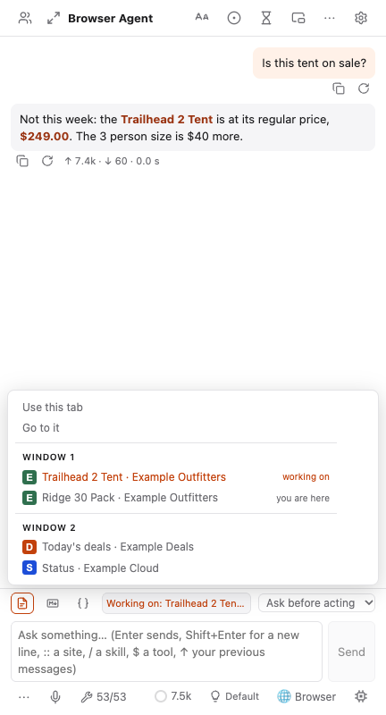

# Compare products across tabs

Open a few product pages and get one answer that compares them all.

**Example:** you are choosing a laptop. Three tabs are open: one on `shop.example.com`, one on `store.example.test`
and one on `deals.example.com`.

## What you need

- The pages open in tabs of the same window.
- The chat open on any of them.

## What you type

> Compare the laptops in my open tabs: price, RAM, weight and warranty, as a table. Which is the best value?

## What you see

1. The chat shows each step as the model goes through your tabs and reads each product page.
2. It answers with a table and a recommendation. Point at the table and click **Copy the table** to paste it into a
   spreadsheet.

The **page bar** under the conversation shows the site of the tab the chat works on. In the side panel, click it to
open the **tab picker**: every open tab, grouped by window, marked *working on* and *you are here*. Pick one to move
the chat there. When you are on another tab than the chat's, **Use this tab** moves the chat to yours and **Go to
it** brings the chat's tab to the front.

## What you approve

- **The tab the chat works on**: nothing, it reads it freely.
- **The other tabs**: on a site set to **Ask before acting**, a card asks before reading it. **Allow on *site* ▾ →
  In this conversation** stops the cards for that site.
- **A site the extension has never read**: a card *Allow reading store.example.test?*. Click **Allow reading
  store.example.test**, then accept the browser's own prompt.

## If it goes wrong

- **It skips a tab in another window**: say so, *"…in all my windows"*.
- **A page shows *not accessible*** (the browser's own pages, the extension store, files on your computer): copy
  the part you need into the message.
- **It reads the wrong tab**: check the site in the page bar and pick the right one in the tab picker.
- **Too many cards**: move the chat to each tab in turn with the tab picker, and ask about each one there.

More details: [The page bar and the tab picker](../guide/chat.md#the-page-bar) ·
[Acting on pages](../guide/acting-on-pages.md) · [Site templates](../guide/site-templates.md).
