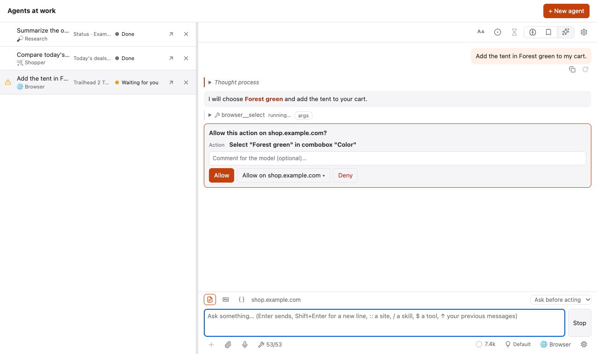

# Run several agents at once

Hand out a few tasks at the same time, each on its own tab, and follow them all from one page: the **Agents Panel**.

**Example:** on a busy morning you want three things done while you read your mail:

| Tab | Task |
|---|---|
| Search results on `shop.example.com` | *"Compare the first five results: price, rating and delivery date."* |
| A sign-up form on `forms.example.test` | *"Fill in this form with my details. Don't send it."* |
| A status page on `status.example.com` | *"Summarize the open incidents."* |

## What you need

- A tab open for each task: the page each agent starts on.
- Optionally, [agents](../guide/agents.md) of your own, each with only the sites and model its task needs.

## What you do

1. Open the **Agents Panel**: the toolbar icon → **Agents Panel**, or its button in the side panel's top bar.
2. Click **+ New agent**, pick the tab in **Work on tab** and the **Agent**, then **Start**.
3. Its chat opens beside the list. Type the task there, as in the side panel.
4. Do the same for the next tab.

## What you see

Each row shows its conversation, its agent, its page, what it is doing and for how long, then **Done**. ⚠ and
**Waiting for you** mean it needs you. Click a row to see its chat. **Go to its tab** brings its tab to the front.

## What you approve

Each agent asks as it would in the side panel: on a site set to **Ask before acting**, its cards wait in its chat. A
row waiting for you does nothing until you click it and answer.

## If it goes wrong

- **A tab is not offered** in **Work on tab**: another row already works on it.
- **Closing the page** stops every agent in it; the browser asks first while one is working. Reopened, it lists them
  again as **Stopped**: click one to go on with it.
- **One task needs another's result**: give both to one chat instead.
- **To stop one agent**: **Remove** stops it (it asks first) and removes its row. Its conversation stays saved.
- **To go back to a past agent's work**: **History** in the page's header, click its conversation (marked with the
  Agents Panel icon), pick a tab, then **Continue**.

More details: [The agent manager](../guide/agent-manager.md) · [Agents](../guide/agents.md) ·
[Acting on pages](../guide/acting-on-pages.md).
