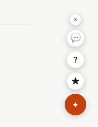

# A one-click widget button

Add a button to the bubble on your pages that translates the text you select, with the answer in a small card on the
page. No chat needed.

**Example:** you read articles on `news.example.com` in a language you only half know, and want a **Translate**
button for the sentences you select.

## What you need

- A model set up.
- The site allowed in **Settings → Website access**.

## What you type

The quickest way is to ask in the chat:

> Make a widget button that translates the selected text to English, only on news.example.com.

The model builds it, tries it on a sample, and shows it in a card before saving: **Allow** saves it.

Or make it yourself in **Settings → Actions → ＋ New action**, a step at a time:

| Step | Value |
|---|---|
| **What it does** | **Answer about the selection** |
| **Where it shows** | Websites: `https://news.example.com/*` |
| **What it takes** | **The selected text** (already chosen) |
| **What it runs** | Prompt: `Translate to English, keeping the formatting: {input}` (`{input}` is your selection) |
| **Try it** | A sample sentence, then **Try** |
| **Name and icon** | *Translate*, and any icon |

Then **Save**.

## What you see

Select a sentence on the page and point at the bubble: its buttons unfold. Click **Translate**: a card on the page
shows the translation. Without a selection, the card asks you to select some text first.

For a summary instead, choose **Open the chat with a message** in **What it does**, **Nothing** in **What it takes**,
and the message *Summarize this page*: one click opens the chat, which answers about the page.

## What you approve

Nothing for this button: the model only answers. What it sends (your selection) goes to the model, like a chat
message. A button that changes something on the page asks in its card first.

## If it goes wrong

- **No bubble on the page**: press **Alt+Shift+W** to show it on this site. **Settings → Bubble** sets where it
  shows and how it looks.
- **The bubble shows, but not the button**: check the action's **Websites**, and that the extension may read the
  site. The editor says *No access yet to …* when it may not.
- **The chat says it cannot create the button**: see
  [Troubleshooting](../guide/troubleshooting.md#browser-cannot-create-skills-tools-or-agents), or make it yourself.

More details: [The page widget](../guide/page-widget.md) · [Agents](../guide/agents.md).
